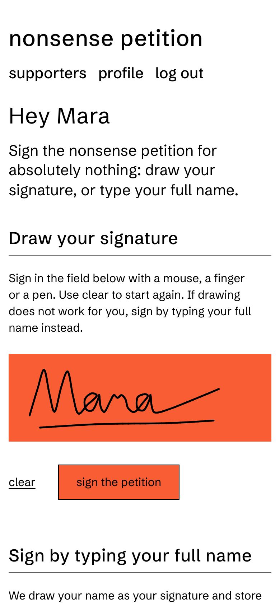
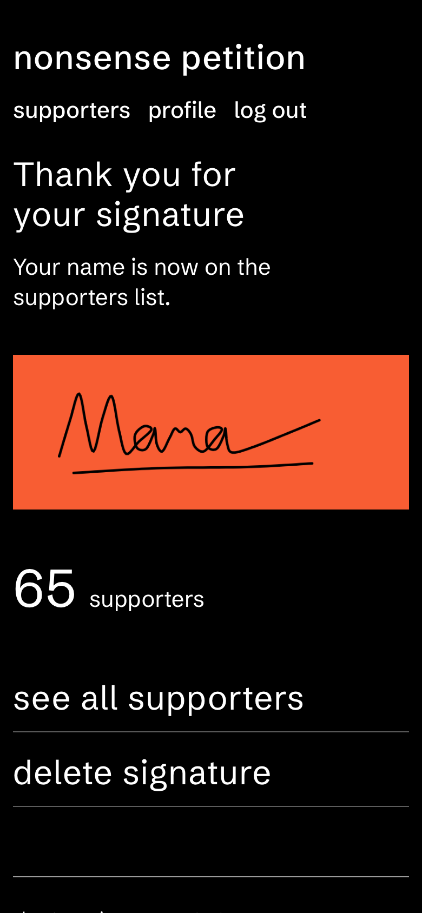
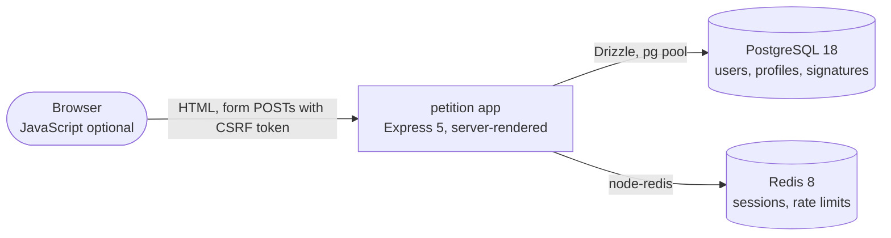

# Nonsense Petition

A tongue-in-cheek petition for absolutely nothing: register, sign with a hand-drawn or typed signature and browse
everyone who signed. I rebuilt it from scratch from my 2018 bootcamp project as a server-rendered Express 5 app that
works without JavaScript, so the interesting parts are the boring ones: forms, sessions, validation and accessibility.

[](https://github.com/Arnoldovna/petition/actions/workflows/ci.yml)
[](https://github.com/Arnoldovna/petition/actions/workflows/release.yml)
[](LICENSE)


**Demo video:** there is no live server, so the [demo page](https://arnoldovna.github.io/petition/) shows the full
recording on desktop and on a phone (published once the repository is public). The videos are also here:
[desktop (MP4)](docs/media/demo-desktop.mp4), [phone (MP4)](docs/media/demo-mobile.mp4). `pnpm demo` runs the same app
locally.


| Mobile: drawing a signature                                                                                                                                                                  | Mobile, dark mode: thank-you page                                                                                                                                                                                               |
| -------------------------------------------------------------------------------------------------------------------------------------------------------------------------------------------- | ------------------------------------------------------------------------------------------------------------------------------------------------------------------------------------------------------------------------------- |
|  |  |

The supporters list in dark mode is in [docs/media/desktop-dark.png](docs/media/desktop-dark.png).

## Features

- **Draw a signature** with a mouse, a finger or a pen (Pointer Events with pointer capture, so a stroke that leaves
  the pad is not lost; a fixed 720 x 240 export whatever the screen density).
- **Or type your name instead**, with or without JavaScript: the server renders it into the same kind of PNG with
  `@napi-rs/canvas`, in Schibsted Grotesk with a Noto Sans fallback. The allowed characters come from the glyphs the
  shipped fonts contain, so "Nguyễn" works and nobody gets empty boxes.
- **Every signature is checked byte by byte**: exact size, chunk CRCs, a deflate-bomb cap, an "is there any ink"
  check, then a re-encode, so only clean PNG bytes land in a `bytea` column and are served from a private route
  ([ADR 0004](docs/architecture/adr/0004-signature-as-validated-png-bytes.md)).
- **Supporters list and city pages**: list and count come from one base query, so they can never disagree again;
  numbered pagination; city links that survive `Frankfurt/Main` and `Halle (Saale)`; `München` and `MÜNCHEN` are one
  city through PostgreSQL's `pg_c_utf8` collation, and emails are trimmed and lower-cased before they are stored
  ([ADR 0007](docs/architecture/adr/0007-case-insensitive-email-and-city.md)).
- **Accounts that behave**: argon2id, one code path for every failed login (no user enumeration by response or
  timing), Redis sessions regenerated on login, a session version so a password change logs out other devices, and
  re-authentication before changing the email or password or deleting the account.
- **Every form works without JavaScript**: post/redirect/get, a 422 re-render with a focused error summary and the
  values kept, CSRF tokens on every POST, and a small script that only prevents double submits.
- **Privacy and accessibility built in**: no third-party request from the browser, a strict CSP without inline
  scripts, a privacy page and a documented erasure command (`pnpm admin:erase`), WCAG 2.2 AA with axe on every page
  and W3C-valid HTML.

## Tech stack

| Area     | Choice                                                                                     | Why                                                                                                                                                     |
| -------- | ------------------------------------------------------------------------------------------ | ------------------------------------------------------------------------------------------------------------------------------------------------------- |
| Server   | Node 26, Express 5, TypeScript 6 (strict)                                                  | Express 5 forwards rejected promises to the error handler, which removes the class of bug that made the 2018 version hang on every failed query.        |
| Views    | express-handlebars, server-rendered HTML                                                   | A petition is a handful of forms. Rendering on the server keeps it fast, indexable and usable without JavaScript, with no client state to keep in sync. |
| Client   | Two small vanilla TypeScript modules (signature pad, form guard), bundled with esbuild     | Progressive enhancement only: the pad replaces nothing, the typed-name form is always there.                                                            |
| Data     | PostgreSQL 18 with Drizzle ORM and versioned migrations                                    | Constraints do real work here (one signature per user, PNG size checks, cascades), and Drizzle keeps the queries typed without hiding the SQL.          |
| Sessions | express-session with Redis, csrf-csrf, express-rate-limit with a Redis store               | Server-side sessions can be revoked; the cookie holds only an opaque id. Rate limits are shared by every app instance.                                  |
| Images   | @napi-rs/canvas                                                                            | Decodes and re-encodes signature PNGs and renders typed names, with prebuilt binaries and no install script.                                            |
| Styling  | Tailwind CSS 4 inside BEM CSS files with design tokens, no utility classes in markup       | Templates stay readable, and a check script plus stylelint keep utility classes out of the markup.                                                      |
| Quality  | Vitest, Supertest + Testcontainers, Playwright + axe, Nu HTML validator, ESLint boundaries | Each layer tests what it is good at, against real Postgres and Redis instead of mocks where it matters.                                                 |
| Delivery | GitHub Actions, a distroless non-root Docker image for GHCR                                | One image runs the app, the migrations and the seed, so the demo is the production build.                                                               |

## Architecture



The app is one Express process with feature modules in [`src/features`](src/features): `pages`, `auth`, `profile`,
`signature` and `supporters`. Each has routes, a controller, a service and a repository, and exports a
`create<Name>Module(deps)` factory from its `index.ts`. [`src/container.ts`](src/container.ts) builds the
dependencies once and [`src/app.ts`](src/app.ts) mounts the modules; there are no singletons, so tests build the same
app with fakes or with a real database. ESLint import boundaries stop one feature from reaching into another's files.
Shared code (guards, form parsing, security middleware, view rendering, field rules in Zod) lives in
[`src/shared`](src/shared). Form errors become a 422 re-render, everything else goes through one error handler that
renders an error page (or RFC 9457 problem details for JSON clients) and never leaks a stack trace. The decisions are
recorded in [docs/architecture/adr](docs/architecture/adr), and [OVERVIEW.md](docs/architecture/OVERVIEW.md) is the
entry point.

## What I learned and what changed since the 2018 version

| 2018 bootcamp version                                                      | 2026 rebuild                                                                                        |
| -------------------------------------------------------------------------- | --------------------------------------------------------------------------------------------------- |
| Node 8, Express 4, `cookie-session` with the user's name in the cookie     | Node 26, Express 5, Redis sessions with an opaque id, idle and absolute timeouts                    |
| Hard-coded configuration, no `.gitignore`                                  | Zod-validated environment, generated local secrets, gitleaks in the pre-commit hook and in CI       |
| HTML built in helpers and printed unescaped (stored XSS)                   | Escaped Handlebars partials only, a strict CSP, an e2e test that stores XSS payloads in every field |
| bcrypt with defaults, different pages for unknown email and wrong password | argon2id, a 12-character minimum, one response and one timing for every failed login                |
| SQL files that start with `DROP TABLE`, swallowed promise errors           | Drizzle schema and migrations, constraints, typed results, Express 5 async error handling           |
| Mouse-only canvas, base64 text in the database                             | Pointer Events for mouse, touch and pen, a typed-name fallback, validated PNG bytes                 |
| jQuery and Google Fonts from CDNs, fixed pixel layout, no labels           | No third-party requests, self-hosted fonts, responsive layout, WCAG 2.2 AA                          |
| No tests                                                                   | Unit, integration against real Postgres and Redis, e2e with axe accessibility checks                |

Before writing any code I audited the old app and wrote down 83 problems in [docs/BUGS.md](docs/BUGS.md), from stored
XSS on the supporters list to a login that hung forever for everyone who had not signed yet. Then I turned them into
acceptance criteria in [docs/FEATURES.md](docs/FEATURES.md), and every test title names the ids it covers. That changed
how I worked more than any library did: the rebuild was done when every item had a fix and, where it could be
tested, a test. The hardest part was not the security work but the signature. A canvas that feels right with a
mouse, a finger and a pen, and a server that refuses everything that is not a real, small, non-empty PNG, took more
iterations than the rest of the forms together. I also learned to treat "works without JavaScript" as a feature with
its own tests, not as a fallback I hope still works.

## Getting started

Requirements: Node 26 (`.nvmrc`), pnpm 10.34.9 (`npm i -g pnpm@10.34.9`), Docker.

Try it (production image, seeded with 64 fictional supporters):

```bash
pnpm install
pnpm demo            # creates .env with generated secrets, starts the stack, prints the URL and demo login
```

The demo runs at the URL `pnpm demo` prints, http://127.0.0.1:3000 by default. Log in with `demo@petition.test` and
the password it prints; that account has not signed yet, so you can try the whole flow. `pnpm stack:down` stops it and
keeps the data. The stack publishes three ports on 127.0.0.1: 3000 for the app, 5432 for Postgres and 6379 for Redis.
If one of them is already taken, set `APP_PORT`, `POSTGRES_PORT` or `REDIS_PORT` in `.env` (the first `pnpm demo`
creates it) and run `pnpm demo` again.

Develop:

```bash
pnpm install
pnpm dev:setup       # .env (generated secrets, never overwritten), Postgres and Redis, migrations, seed
pnpm dev             # app with watchers for server, CSS and client on http://127.0.0.1:3000
```

`pnpm demo` and `pnpm dev` share the Postgres and Redis containers and both serve on port 3000 by default, so run one
at a time. If you change `POSTGRES_PORT` or `REDIS_PORT` for `pnpm dev`, change the port in `DATABASE_URL` or
`REDIS_URL` too (`pnpm dev:setup` checks the database URL).

## Scripts

| Script                                                  | What it does                                                                                                     |
| ------------------------------------------------------- | ---------------------------------------------------------------------------------------------------------------- |
| `pnpm demo`                                             | production image with demo data, for a quick look                                                                |
| `pnpm dev:setup`                                        | one-time local setup (idempotent)                                                                                |
| `pnpm dev`                                              | server (tsx watch), Tailwind and esbuild in watch mode                                                           |
| `pnpm build`                                            | fonts, CSS, client bundle and asset manifest, then the TypeScript build into `dist/`                             |
| `pnpm verify`                                           | everything CI runs: format, lint, stylelint, utility-class check, types, unit, integration, build, e2e, gitleaks |
| `pnpm test` / `pnpm test:integration` / `pnpm test:e2e` | unit / Supertest against real Postgres and Redis / Playwright with axe on an isolated stack                      |
| `pnpm db:generate` / `db:migrate` / `db:seed`           | migrations and demo data                                                                                         |
| `pnpm admin:erase`                                      | deletes one user and everything that belongs to them (erasure on request)                                        |
| `pnpm stack:down`                                       | stops the demo or local production stack and keeps its data                                                      |
| `pnpm media:readme`                                     | regenerates the `docs/media/` screenshots and the social preview against the running demo                        |
| `pnpm media:record`                                     | records the demo video (desktop and phone) against the running demo: WebM, MP4 and the README GIF                |
| `pnpm site:build`                                       | builds the GitHub Pages demo page into `dist/site`                                                               |

## Testing

- **Unit** (Vitest, `pnpm test`): field rules, the PNG checks, the signature pad's stroke logic, services with fakes,
  view helpers, plus repository rules (no legacy patterns, every FEATURES and BUGS id traced to a test or a documented
  reason).
- **Integration** (Supertest and Testcontainers, `pnpm test:integration`): every route against real PostgreSQL and
  Redis, one database per test file, including the guard matrix for guests, signed-in and signed users, CSRF, rate
  limits, session expiry and the security headers.
- **End to end** (Playwright, `pnpm test:e2e`): the production image in its own compose project on port 8182, so it can
  run next to the demo. Journeys with and without JavaScript, drawing with mouse and touch (also on WebKit), XSS
  payloads, axe on every page and state, keyboard-only use, 320px width and 200% zoom, and every page checked by the
  Nu HTML validator.
- `pnpm verify` runs all of it locally, and I run it before every commit; flaky tests are fixed, never retried.

## CI/CD

`ci.yml` runs lint (including schema drift and the utility-class check), type checks, unit, integration, build, a
`pnpm dev:setup` smoke run and gitleaks on every pull request and push to `main`; the e2e job runs on pull requests only.
`release.yml` builds the image of a commit that passed CI on `main` and pushes it to
`ghcr.io/arnoldovna/petition` with provenance and an SBOM, but only once the repository is public. The deploy job is
prepared and stays off until `DEPLOY_ENABLED` is set. A weekly `audit.yml` runs `pnpm audit`. `pages.yml` publishes
the demo page (`site/`) to GitHub Pages, also only while the repository is public. Operations, the deploy
checklist and the erasure procedure are in [docs/OPERATIONS.md](docs/OPERATIONS.md).

## Credits

- Typeface: [Schibsted Grotesk](https://github.com/schibsted/schibsted-grotesk) by the Schibsted Grotesk Project
  Authors, SIL Open Font License 1.1, self-hosted via @fontsource. Licence text in
  [LICENSES/OFL-SchibstedGrotesk.txt](LICENSES/OFL-SchibstedGrotesk.txt).
- [Noto Sans](https://github.com/notofonts/latin-greek-cyrillic) by the Noto Project Authors, SIL Open Font License
  1.1, used only on the server as a fallback when rendering typed signatures; the browser never loads it. Licence text
  in [LICENSES/OFL-NotoSans.txt](LICENSES/OFL-NotoSans.txt).
- The favicon and app icons were made for this project, rendered from [public/favicon.svg](public/favicon.svg). The
  64 supporters in the demo are fictional (`.test` emails, `.example` homepages) and their signatures are generated by
  the seed script. The app uses no photographs or other third-party images.

## License

MIT, see [LICENSE](LICENSE).
