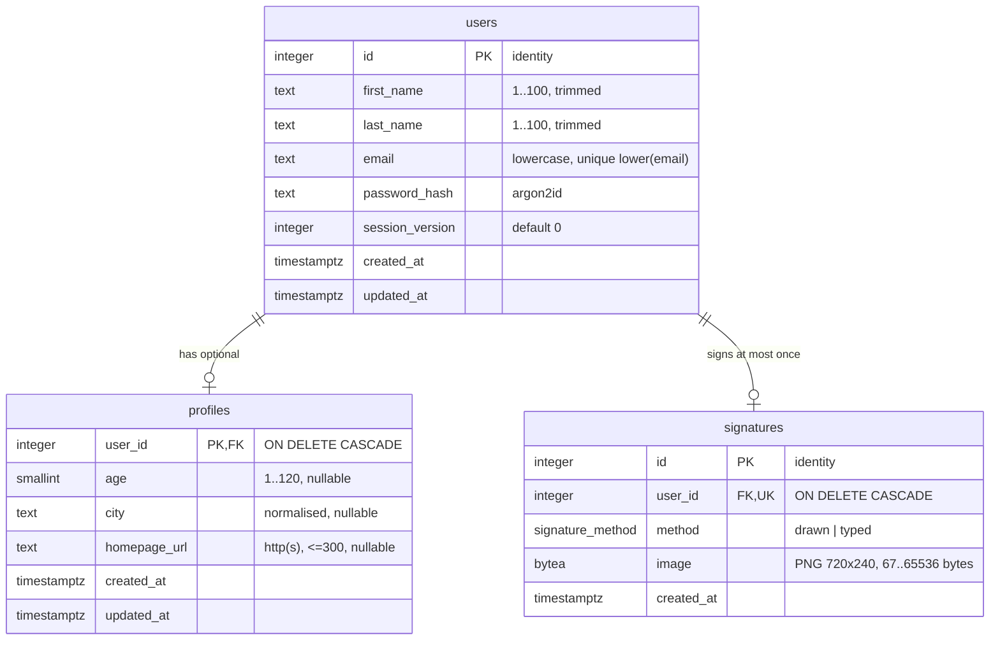

# petition: Data model

PostgreSQL 18, Drizzle ORM 0.45.4 (node-postgres driver), drizzle-kit 0.31.11. Conventions follow the
`express-feature-module` skill (`references/data.md`): identity primary keys, `timestamptz` everywhere,
`casing: 'snake_case'` in both `drizzle()` and `drizzle.config.ts` (TypeScript keys camelCase, columns snake_case),
explicit `onDelete`, invariants as database constraints with Zod as the first line of defence.

Related decisions: ADR 0004 (signature bytes), ADR 0006 (supporters query), ADR 0007 (email and city matching),
ADR 0002 (`session_version`), ADR 0013 (cascades).

## 1. Entity relationship



Legacy-to-rebuild naming (B-53): `registered_users` -> `users`, `save` -> `signatures`, `user_profiles` ->
`profiles`, `password` -> `password_hash`, `url`/`homepage` -> `homepage_url`, `first`/`last` -> `first_name`/`last_name`.

## 2. Drizzle schema

Files: `src/db/schema/{types.ts, users.ts, profiles.ts, signatures.ts, index.ts}`. `index.ts` re-exports all tables
and the enum. Regular expressions inside `sql` template literals need doubled backslashes (`\\s`), because the TypeScript
template literal consumes one level.

### 2.1 `types.ts`

```ts
import { customType } from 'drizzle-orm/pg-core';

/** drizzle-orm 0.45 has no bytea builder. node-postgres returns bytea as Buffer. */
export const bytea = customType<{ data: Buffer; driverData: Buffer }>({
  dataType: () => 'bytea',
});
```

### 2.2 `users.ts`

```ts
import { sql } from 'drizzle-orm';
import { check, integer, pgTable, text, timestamp, uniqueIndex } from 'drizzle-orm/pg-core';

export const users = pgTable(
  'users',
  {
    id: integer().primaryKey().generatedAlwaysAsIdentity(),
    firstName: text().notNull(),
    lastName: text().notNull(),
    email: text().notNull(),
    passwordHash: text().notNull(),
    sessionVersion: integer().notNull().default(0),
    createdAt: timestamp({ withTimezone: true }).notNull().defaultNow(),
    updatedAt: timestamp({ withTimezone: true })
      .notNull()
      .defaultNow()
      .$onUpdate(() => new Date()),
  },
  (t) => [
    uniqueIndex('users_email_lower_idx').on(sql`lower(${t.email})`),
    check(
      'users_first_name_chk',
      sql`${t.firstName} = btrim(${t.firstName}) AND char_length(${t.firstName}) BETWEEN 1 AND 100 AND ${t.firstName} !~ '[[:cntrl:]]'`,
    ),
    check(
      'users_last_name_chk',
      sql`${t.lastName} = btrim(${t.lastName}) AND char_length(${t.lastName}) BETWEEN 1 AND 100 AND ${t.lastName} !~ '[[:cntrl:]]'`,
    ),
    check(
      'users_email_chk',
      sql`${t.email} = lower(btrim(${t.email})) AND char_length(${t.email}) BETWEEN 3 AND 254 AND position('@' in ${t.email}) > 1`,
    ),
    check('users_password_hash_chk', sql`${t.passwordHash} LIKE '$argon2id$%'`),
    check('users_session_version_chk', sql`${t.sessionVersion} >= 0`),
  ],
);
```

### 2.3 `profiles.ts`

```ts
import { sql } from 'drizzle-orm';
import { check, index, integer, pgTable, smallint, text, timestamp } from 'drizzle-orm/pg-core';
import { users } from './users.js';

export const profiles = pgTable(
  'profiles',
  {
    userId: integer()
      .primaryKey()
      .references(() => users.id, { onDelete: 'cascade' }),
    age: smallint(),
    city: text(),
    homepageUrl: text(),
    createdAt: timestamp({ withTimezone: true }).notNull().defaultNow(),
    updatedAt: timestamp({ withTimezone: true })
      .notNull()
      .defaultNow()
      .$onUpdate(() => new Date()),
  },
  (t) => [
    check('profiles_age_chk', sql`${t.age} BETWEEN 1 AND 120`),
    check(
      'profiles_city_chk',
      sql`${t.city} = btrim(${t.city}) AND ${t.city} !~ '\\s{2,}' AND char_length(${t.city}) BETWEEN 1 AND 100`,
    ),
    check(
      'profiles_homepage_url_chk',
      sql`char_length(${t.homepageUrl}) <= 300 AND ${t.homepageUrl} ~ '^https?://[^\\s]+$'`,
    ),
    // Case-insensitive city lookup, independent of the database default locale (ADR 0007).
    index('profiles_city_key_idx').on(sql`lower(${t.city} COLLATE "pg_c_utf8")`),
  ],
);
```

CHECK constraints pass when the column is NULL, so every optional field stays optional (F-34).

### 2.4 `signatures.ts`

```ts
import { sql } from 'drizzle-orm';
import { check, index, integer, pgEnum, pgTable, timestamp } from 'drizzle-orm/pg-core';
import { bytea } from './types.js';
import { users } from './users.js';

export const signatureMethod = pgEnum('signature_method', ['drawn', 'typed']);

export const signatures = pgTable(
  'signatures',
  {
    id: integer().primaryKey().generatedAlwaysAsIdentity(),
    userId: integer()
      .notNull()
      .unique('signatures_user_id_key')
      .references(() => users.id, { onDelete: 'cascade' }),
    method: signatureMethod().notNull(),
    image: bytea().notNull(),
    createdAt: timestamp({ withTimezone: true }).notNull().defaultNow(),
  },
  (t) => [
    check('signatures_image_size_chk', sql`octet_length(${t.image}) BETWEEN 67 AND 65536`),
    check('signatures_image_png_chk', sql`substring(${t.image} FROM 1 FOR 8) = '\\x89504e470d0a1a0a'::bytea`),
    index('signatures_created_at_id_idx').on(t.createdAt, t.id),
  ],
);
```

## 3. Constraint and index summary

| Table      | Constraint / index                                           | Purpose                                                | Covers                 |
| ---------- | ------------------------------------------------------------ | ------------------------------------------------------ | ---------------------- |
| users      | PK `id` identity                                             |                                                        |                        |
| users      | `users_email_lower_idx` UNIQUE on `lower(email)`             | one account per email, case-insensitive                | F-02, F-20, F-64, B-25 |
| users      | `users_email_chk`                                            | stored lowercase, trimmed, length 3..254, contains `@` | F-19, B-61             |
| users      | `users_first_name_chk`, `users_last_name_chk`                | trimmed, 1..100, no control chars                      | F-02, F-19, B-24, B-61 |
| users      | `users_password_hash_chk`                                    | only argon2id hashes can be stored                     | F-27, B-11             |
| users      | `users_session_version_chk`                                  | non-negative                                           | ADR 0002               |
| profiles   | PK and FK `user_id` -> `users.id` ON DELETE CASCADE          | at most one profile, no surrogate key, no orphans      | F-04, F-06, B-34, B-61 |
| profiles   | `profiles_age_chk` 1..120                                    |                                                        | F-04, F-35, B-27       |
| profiles   | `profiles_city_chk`                                          | normalised city text                                   | F-04, F-35, B-32       |
| profiles   | `profiles_homepage_url_chk`                                  | http/https only, at most 300 chars, no whitespace      | F-04, F-35, B-18       |
| profiles   | `profiles_city_key_idx` on `lower(city COLLATE "pg_c_utf8")` | city page lookup                                       | F-05, F-56, B-61       |
| signatures | UNIQUE `signatures_user_id_key`                              | exactly one signature per user, also the FK index      | F-03, F-43, B-07, B-49 |
| signatures | FK `user_id` ON DELETE CASCADE                               |                                                        | F-03, F-06, B-34       |
| signatures | `signatures_image_size_chk` 67..65536 bytes                  | no empty or oversized payloads                         | F-42, B-19             |
| signatures | `signatures_image_png_chk`                                   | PNG magic number as backstop                           | F-42, B-19             |
| signatures | `signatures_created_at_id_idx` (created_at, id)              | stable ordering of supporters                          | F-05, F-54, B-31       |

All timestamps are `timestamptz` (B-61). There are no other foreign keys, so no further FK indexes are needed.

## 4. Queries (repository level)

Only `*.repository.ts` files (plus `features/auth/credentials.ts`, `src/tools/*` and `src/db/migrate.ts`) contain
SQL; `src/shared` contains none (ADR 0001). Every query is parameterised; `sql.raw` is banned by an ESLint
`no-restricted-syntax` rule.

| Repository method                                                                              | SQL shape                                                                                                                                                                                                                                                                                                 | Module                   |
| ---------------------------------------------------------------------------------------------- | --------------------------------------------------------------------------------------------------------------------------------------------------------------------------------------------------------------------------------------------------------------------------------------------------------- | ------------------------ |
| `viewer.findViewer(userId)` (`features/auth/viewer.repository.ts`, injected into `loadViewer`) | `SELECT u.id, u.first_name, u.session_version, s.user_id IS NOT NULL AS has_signed FROM users u LEFT JOIN signatures s ON s.user_id = u.id WHERE u.id = $1`                                                                                                                                               | auth                     |
| `auth.insertUser(input)`                                                                       | `INSERT INTO users (...) RETURNING id, session_version`; 23505 -> `email-taken`                                                                                                                                                                                                                           | auth                     |
| `auth.findForLogin(email)`                                                                     | `SELECT u.id, u.password_hash, u.session_version, s.user_id IS NOT NULL AS has_signed FROM users u LEFT JOIN signatures s ON ... WHERE lower(u.email) = $1`                                                                                                                                               | auth                     |
| `auth.updatePasswordHash(id, hash)`                                                            | rehash on login                                                                                                                                                                                                                                                                                           | auth                     |
| `credentials.findPasswordHash(id)` (`features/auth/credentials.ts`)                            | for every current-password check (account deletion, profile edit)                                                                                                                                                                                                                                         | auth                     |
| `credentials.apply(tx, id, { email?, passwordHash? })`                                         | `UPDATE users SET email = $2[, password_hash = $3, session_version = session_version + 1] WHERE id = $1` inside the caller's transaction; 23505 -> `email-taken`                                                                                                                                          | auth (called by profile) |
| `auth.deleteUser(id)`                                                                          | `DELETE FROM users WHERE id = $1` inside `db.transaction`; returns `rowCount > 0`                                                                                                                                                                                                                         | auth                     |
| `profile.findProfile(userId)`                                                                  | `SELECT age, city, homepage_url FROM profiles WHERE user_id = $1`                                                                                                                                                                                                                                         | profile                  |
| `profile.upsertProfile(userId, fields)`                                                        | `INSERT ... ON CONFLICT (user_id) DO UPDATE SET age = EXCLUDED.age, ...`                                                                                                                                                                                                                                  | profile                  |
| `profile.findAccount(userId)`                                                                  | `SELECT u.first_name, u.last_name, u.email, p.age, p.city, p.homepage_url FROM users u LEFT JOIN profiles p ON p.user_id = u.id WHERE u.id = $1` (B-55: LEFT JOIN, not FULL OUTER; no password hash)                                                                                                      | profile                  |
| `profile.updateAccount(userId, changes, credentials)`                                          | one `db.transaction`: `UPDATE users SET first_name, last_name`, then `credentials.apply(tx, ...)` when email or password change, then the profile upsert; `email-taken` -> rollback                                                                                                                       | profile                  |
| `signature.insertIfAbsent(userId, method, image)`                                              | `INSERT ... ON CONFLICT (user_id) DO NOTHING`                                                                                                                                                                                                                                                             | signature                |
| `signature.findImage(userId)`                                                                  | `SELECT image FROM signatures WHERE user_id = $1`                                                                                                                                                                                                                                                         | signature                |
| `signature.deleteByUser(userId)`                                                               | `DELETE ... WHERE user_id = $1`; returns boolean                                                                                                                                                                                                                                                          | signature                |
| `supporters.list({ city?, limit, offset })`                                                    | `SELECT u.first_name, u.last_name, p.age, p.city, p.homepage_url, s.created_at FROM signatures s JOIN users u ON u.id = s.user_id LEFT JOIN profiles p ON p.user_id = s.user_id [WHERE lower(p.city COLLATE "pg_c_utf8") = lower($1 COLLATE "pg_c_utf8")] ORDER BY s.created_at, s.id LIMIT $2 OFFSET $3` | supporters               |
| `supporters.count({ city? })`                                                                  | same `FROM`/`WHERE` builder, `SELECT count(*)::int`                                                                                                                                                                                                                                                       | supporters               |

## 5. Migration plan

1. **Scaffold phase:** write the four schema files above, run `pnpm db:generate` once to produce
   `drizzle/0000_init.sql` and `drizzle/meta/*`. Review the SQL by hand:
   - `CREATE TYPE "signature_method" AS ENUM ('drawn', 'typed')` before `signatures`.
   - Every CHECK name and expression as above; regexes contain single backslashes in SQL.
   - The expression index reads `lower(("city" COLLATE "pg_c_utf8"))` (or equivalent).
   - Both foreign keys say `ON DELETE cascade`.
   - No `DROP` statements (B-60).
     Commit `drizzle/` with the schema in the same commit.
2. **Apply:** `pnpm db:migrate` locally (`src/db/migrate.ts` with drizzle's `migrate()`), the `migrate` compose
   one-shot in Docker, and `test/global-setup.ts` for every integration run. The web process never migrates.
3. **Schema test:** `src/db/__tests__/schema.int.test.ts` inserts violating rows directly through Drizzle and expects
   each named constraint to fire (23514 check, 23505 unique, 23503 FK), and proves cascade deletion and the
   `pg_c_utf8` lower-casing (`'MÜNCHEN'` matches `'München'`).
4. **Later changes:** new numbered migrations only; never edit an applied migration. Destructive changes (drop or
   rename column) go in two releases (expand, then contract).

## 6. Seed plan

`src/tools/seed.ts` (entry), `src/tools/seed-data.ts` (data) and `src/tools/seed-signatures.ts` (generator). The seed is
a tooling element (ADR 0001): it imports `createSignatureImages` from `features/signature/index.ts`, the hasher from
`shared/auth/password.ts` and the schema from `db`. Run with `pnpm db:seed` locally and by the `seed` compose one-shot
(profiles `demo` and `e2e` only, after `migrate`, before `app`) for the demo, E2E and README screenshots.

**Rules**

- Runs only with `SEED_ALLOW=true` set explicitly, whatever `NODE_ENV` is (`pnpm db:seed` and the compose `seed`
  service set it per invocation; it is never an `.env` key; the service does not override `NODE_ENV`). Without it the
  seed exits 1 (exported guard `assertSeedAllowed(env)`).
- When `users` contains any email outside `@petition.test`, the seed writes nothing, logs
  `seed.skipped {reason: 'foreign-users'}` and exits 0, so a second `pnpm demo` or `pnpm dev:setup` after a
  registration still succeeds (ADR 0016, ADR 0019 §7).
- Reads `SEED_DEMO_PASSWORD` (at least 12 characters, required). All seed users share it; nothing is hard-coded.
- Idempotent: users `onConflictDoNothing()` (email index), profiles upsert, signatures `onConflictDoNothing()` on
  `user_id`. Running it twice changes nothing.
- One transaction for the whole seed.
- No real personal data, nothing from the legacy database. All emails use the reserved `.test` TLD
  (`<first>.<last>@petition.test`, ASCII-folded: `Weiß` -> `weiss`, `Şahin` -> `sahin`). Homepages use the reserved
  `.example` TLD, so no link points at a real person.
- **Images:** no external photos. Signature PNGs are generated at seed time with the production code paths:
  - `typed`: `renderTypedSignature(fullName)` (ADR 0005).
  - `drawn`: `renderGeneratedSignature(fullName)` in `src/tools/seed-signatures.ts`, a deterministic generator
    (PRNG seeded by a hash of the name) that draws 1 to 3 pen strokes: a baseline-hugging cursive wave with 3 to 6
    loops, a rising initial stroke, and sometimes an underline flourish, at 3 px round line width, black on
    transparent, 720 x 240. These are generated abstract placeholders; no attribution is needed.
  - Every generated image passes through `validateDrawnSignature` before insert, so seeds prove the validator accepts
    realistic input.
- Signing times are fixed (deterministic screenshots): supporter `i` (0-based) signs at
  `2026-09-02T08:14:00Z + i * 25h + ((i * 37) mod 180) min`, which spreads 64 signatures from 2 Sep to about
  9 Nov 2026. User `created_at` is 5 to 40 minutes before the signature.

**Demo account** (unsigned, so a reviewer can try the full flow): Mara Lindholm, `demo@petition.test`, age 31,
city Leipzig, homepage none.

**Supporters** (64; "-" means not set; "no profile" means no `profiles` row at all, to prove B-30 is fixed):

| #   | Name               | Age        | City                     | Homepage                        | Method |
| --- | ------------------ | ---------- | ------------------------ | ------------------------------- | ------ |
| 1   | Lena Hartmann      | 34         | Leipzig                  | https://lena-hartmann.example   | typed  |
| 2   | Jonas Becker       | 41         | Hamburg                  | -                               | drawn  |
| 3   | Aylin Demir        | 27         | Berlin                   | https://aylin-draws.example     | drawn  |
| 4   | Mateusz Nowak      | -          | Frankfurt/Main           | -                               | typed  |
| 5   | Giulia Romano      | 52         | München                  | -                               | drawn  |
| 6   | Henrik Lindqvist   | 38         | Zürich                   | https://lindqvist.example       | typed  |
| 7   | Sophie Wagner      | no profile |                          |                                 | drawn  |
| 8   | Kwame Mensah       | 45         | Köln                     | -                               | typed  |
| 9   | Eleni Papadopoulou | 29         | Wien                     | https://eleni-p.example         | drawn  |
| 10  | Thanh Nguyễn       | 33         | Berlin                   | -                               | typed  |
| 11  | Marta Kowalczyk    | 61         | Dresden                  | -                               | drawn  |
| 12  | Felix Schneider    | 23         | Freiburg im Breisgau     | -                               | drawn  |
| 13  | Inês Carvalho      | 36         | St. Gallen               | https://ines-carvalho.example   | typed  |
| 14  | Yusuf Arslan       | 48         | -                        | -                               | drawn  |
| 15  | Clara Fischer      | -          | Halle (Saale)            | -                               | typed  |
| 16  | Niklas Brandt      | 30         | Rostock                  | -                               | drawn  |
| 17  | Amara Okafor       | 26         | Hamburg                  | https://amara-okafor.example    | typed  |
| 18  | Paul Zimmermann    | 72         | Bremen                   | -                               | drawn  |
| 19  | Hanna Weiß         | 39         | Graz                     | -                               | typed  |
| 20  | Lukas Hofer        | 44         | Graz                     | -                               | drawn  |
| 21  | Mia Schulz         | no profile |                          |                                 | typed  |
| 22  | Emre Kaya          | 31         | Berlin                   | -                               | drawn  |
| 23  | Ingrid Solberg     | 57         | Leipzig                  | -                               | typed  |
| 24  | Tobias Krüger      | 28         | Brandenburg an der Havel | -                               | drawn  |
| 25  | Zofia Wiśniewska   | 35         | Frankfurt/Main           | -                               | typed  |
| 26  | Daniel Roth        | 50         | Köln                     | https://danielroth.example      | drawn  |
| 27  | Leonie Vogel       | 22         | München                  | -                               | typed  |
| 28  | Marco Bianchi      | 46         | Zürich                   | -                               | drawn  |
| 29  | Selin Yıldız       | 24         | Hamburg                  | -                               | typed  |
| 30  | Johanna Lehmann    | 67         | Dresden                  | -                               | drawn  |
| 31  | Samuel Adeyemi     | 37         | Berlin                   | https://adeyemi.example         | typed  |
| 32  | Katharina Braun    | no profile |                          |                                 | drawn  |
| 33  | Oskar Nilsson      | 42         | Wien                     | -                               | typed  |
| 34  | Lea Hoffmann       | 31         | Leipzig                  | -                               | drawn  |
| 35  | Ali Haddad         | 29         | Köln                     | -                               | typed  |
| 36  | Charlotte Meyer    | 55         | Bremen                   | -                               | drawn  |
| 37  | Ben Schäfer        | 19         | Rostock                  | -                               | typed  |
| 38  | Nora Lindgren      | 40         | St. Gallen               | -                               | drawn  |
| 39  | Piotr Zieliński    | 53         | Berlin                   | -                               | typed  |
| 40  | Valentina Costa    | 27         | München                  | https://valentina-costa.example | drawn  |
| 41  | Moritz Kühn        | -          | Halle (Saale)            | -                               | typed  |
| 42  | Elif Şahin         | 34         | Frankfurt/Main           | -                               | drawn  |
| 43  | Anton Weber        | 78         | Freiburg im Breisgau     | -                               | typed  |
| 44  | Laura Klein        | no profile |                          |                                 | drawn  |
| 45  | Fatima Benali      | 30         | Hamburg                  | -                               | typed  |
| 46  | Jakob Huber        | 36         | Graz                     | -                               | drawn  |
| 47  | Emilia Sommer      | 25         | Leipzig                  | https://emilia-sommer.example   | typed  |
| 48  | Max Neumann        | 47         | Berlin                   | -                               | drawn  |
| 49  | Tereza Horáková    | 33         | Wien                     | -                               | typed  |
| 50  | Erik Johansson     | 58         | Zürich                   | -                               | drawn  |
| 51  | Pia Lorenz         | no profile |                          |                                 | typed  |
| 52  | David Cohen        | 39         | Berlin                   | -                               | drawn  |
| 53  | Annika Petersen    | 44         | Bremen                   | -                               | typed  |
| 54  | Rafael Moreira     | 28         | Köln                     | -                               | drawn  |
| 55  | Greta Albrecht     | 63         | Dresden                  | -                               | typed  |
| 56  | Hamza Yilmaz       | 35         | München                  | -                               | drawn  |
| 57  | Ida Kristensen     | 31         | Hamburg                  | -                               | typed  |
| 58  | Simon Graf         | 26         | St. Gallen               | -                               | drawn  |
| 59  | Marlene Fuchs      | -          | Leipzig                  | -                               | typed  |
| 60  | Viktor Petrov      | 49         | Berlin                   | -                               | drawn  |
| 61  | Rosa Martínez      | 37         | Frankfurt/Main           | https://rosa-martinez.example   | typed  |
| 62  | Till Hansen        | no profile |                          |                                 | drawn  |
| 63  | Hiroshi Tanaka     | 54         | Köln                     | -                               | typed  |
| 64  | Alma Berg          | 21         | Rostock                  | -                               | drawn  |

E2E starts every run from an empty database plus this seed (ADR 0017), and only the `seed-readonly` Playwright project
asserts these exact numbers, before any mutating spec runs (every other project, `webkit-iphone` included, depends on
it). Integration tests never use the seed except `seed.int.test.ts`, which has its own database.

Why this set: 64 > 50 gives a second supporters page (F-54); Berlin has 8 and Leipzig 5 (6 with the demo account after
signing) for the city page; `Frankfurt/Main`, `Halle (Saale)`, `St. Gallen`, `Brandenburg an der Havel`, `München`,
`Köln`, `Zürich` exercise encoding and Unicode matching (F-57); profiles with only city, only age or nothing prove
separator-free rendering (F-52); names with `ß`, `ł`, `ś`, `ı`, `ş`, `á`, `í`, `ê` prove latin-ext rendering for typed
signatures, and the typed `Thanh Nguyễn` (`ễ` is not in Schibsted Grotesk) proves the Noto Sans fallback (ADR 0005).

## 7. Data protection notes

- Stored personal data: names, email, optional age, city, homepage, signature image. No IP addresses are stored in
  the database. Rate-limit keys in Redis expire after their window (at most one hour) and contain an IPv4 address or
  IPv6 /56 prefix and, for email limiters, an HMAC-SHA256 of the normalised email under a key derived from the session
  secret, which a dictionary cannot reverse without the server secret (ADR 0012).
- The privacy page (`GET /privacy`, F-88) states what is stored, who sees it, retention and how to delete; register and
  onboarding say that name, age, city and homepage appear on the supporters list (F-90, ADR 0016).
- Account deletion is a hard delete with cascade (ADR 0013). Sessions of a deleted user become guests on their next
  request (ADR 0002) and expire in Redis by TTL.
- Logs contain user ids, never names, emails, passwords, hashes or images (ADR 0011).
- Erasure without a password (lost password) is done on request with `pnpm admin:erase` (`src/tools/erase-user.ts`),
  using the same cascade transaction (ADR 0013, ADR 0016, F-91).
