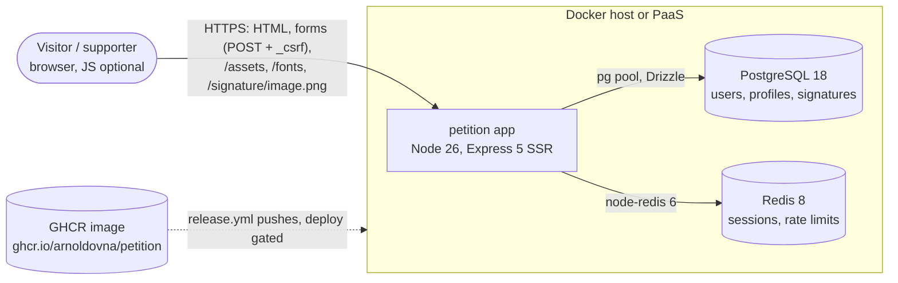
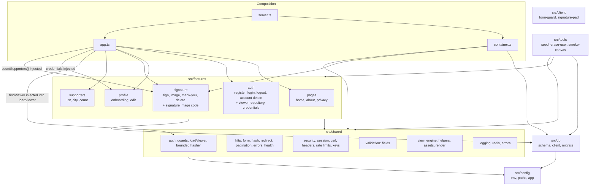
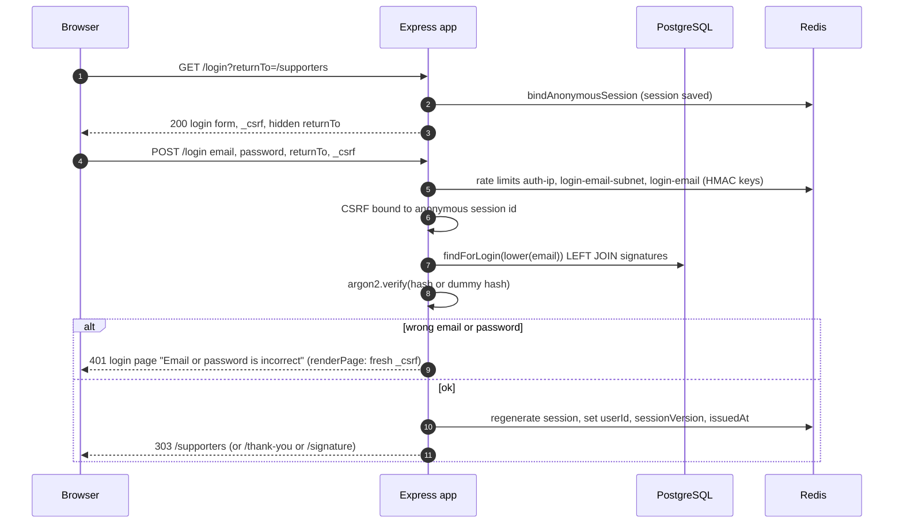

# petition: Architecture overview

"Nonsense Petition" is a tongue-in-cheek petition for absolutely nothing. A visitor registers, optionally adds age,
city and homepage, signs with a hand-drawn (or typed) signature, sees a thank-you page with their signature and the
supporter count, browses all supporters (also by city), edits their profile, deletes their signature or deletes their
account.

This document is the entry point. Binding inputs: `/Users/marina/Code/PLAN.md` (architecture table, quality gate,
definition of done), [FEATURES.md](../FEATURES.md) (acceptance criteria F-01 to F-91), [BUGS.md](../BUGS.md) (B-01 to
B-83, all must be resolved) and the skills `express-feature-module`, `project-scaffold`, `modular-css-tailwind4`,
`maw-design-system`. Details live in [DATA-MODEL.md](./DATA-MODEL.md), [ROUTES.md](./ROUTES.md),
[BUILD-ORDER.md](./BUILD-ORDER.md) and the [ADRs](./adr/).

The legacy code (`~/Code/_legacy/src/petition`, 2018) is reference only. Nothing is copied from it, least of all
configuration values or secrets.

---

## 1. Context and constraints

| Constraint | Source | Consequence |
|---|---|---|
| Single Express 5 SSR app, express-handlebars, Tailwind CLI, Redis sessions | PLAN.md, project table | ADR 0001 |
| Feature modules, ESLint import boundaries, factory DI, no singletons | PLAN.md, `express-feature-module` | sections 4, 7 |
| Every form works without JavaScript; drawing has a typed-name fallback | F-45, F-76 | ADR 0005, ADR 0010 |
| No real-time features, no file uploads besides the signature | F-10, F-11 | sections 10, 11 |
| maw-studio identity, accent vermilion `#F85D33`, Schibsted Grotesk, no utility classes in markup | PLAN.md, `maw-design-system`, `modular-css-tailwind4` | ADR 0014, section 15 |
| WCAG 2.2 AA, axe clean, W3C-valid HTML | F-78 to F-87 | ADR 0015 |
| Repo private, MIT licence `Arnoldovna`, English everywhere | PLAN.md, `project-scaffold` | |
| Privacy notice where data is collected, imprint link, erasure on request | GDPR Art. 13 and 17, section 5 DDG, F-88 to F-91 | ADR 0016 |
| Parallel units in one working tree with disjoint files and scoped checks, one gate per phase (cross-project conventions) | PLAN.md (parallel phases), `project-scaffold/references/conventions.md`, BUILD-ORDER.md | ADR 0017 |

## 2. Decisions

### 2.1 ADR index

| ADR | Decision |
|---|---|
| [0001](./adr/0001-single-ssr-app-with-feature-modules.md) | Single Express SSR app with feature modules |
| [0002](./adr/0002-redis-sessions-and-per-request-viewer.md) | Redis sessions, per-request viewer from the DB, session versioning |
| [0003](./adr/0003-csrf-signed-double-submit-for-forms.md) | csrf-csrf with form field tokens, POST-only state changes |
| [0004](./adr/0004-signature-as-validated-png-bytes.md) | Signature as validated, re-encoded PNG bytes in `bytea`, private image route |
| [0005](./adr/0005-server-side-image-processing-with-napi-rs-canvas.md) | @napi-rs/canvas for PNG decode/re-encode and typed-name signatures |
| [0006](./adr/0006-supporters-query-count-and-offset-pagination.md) | One base query for list and count, numbered offset pagination |
| [0007](./adr/0007-case-insensitive-email-and-city.md) | Case-insensitive email and city with `pg_c_utf8` |
| [0008](./adr/0008-ssr-form-handling-and-error-pages.md) | Form Result types, PRG, 422 re-render, flash, error pages |
| [0009](./adr/0009-password-policy-and-reauthentication.md) | Password 12..128, argon2id, constant-path login, re-auth |
| [0010](./adr/0010-progressive-enhancement-client-and-asset-pipeline.md) | Vanilla TS progressive enhancement, hashed self-hosted assets |
| [0011](./adr/0011-security-headers-logging-and-configuration.md) | Strict CSP, pino redaction, Zod env |
| [0012](./adr/0012-rate-limiting.md) | Configurable Redis rate limits per IP /56, keyed email HMAC and user |
| [0013](./adr/0013-deletion-flows.md) | Confirmation pages, cascades, re-auth for account deletion |
| [0014](./adr/0014-views-and-css-architecture.md) | Handlebars view rules, BEM + Tailwind 4 via `@apply`, maw tokens |
| [0015](./adr/0015-test-and-delivery-pipeline.md) | Test layers, Nu validator, `pnpm setup:env`/`dev:setup`/`demo`, CI/CD, pnpm version |
| [0016](./adr/0016-privacy-notice-imprint-and-erasure.md) | Privacy page, imprint link, disclosure, erasure on request, seed guard |
| [0017](./adr/0017-test-isolation-and-parallel-builds.md) | Database per test file, test-only sign-in, isolated E2E stacks, merge rule |

### 2.2 FEATURES amendments (applied to `docs/FEATURES.md` in the scaffold phase)

| Id | Change | Reason |
|---|---|---|
| F-19 | Password length 10..128 becomes **12..128** | Skill non-negotiable, ADR 0009 |
| F-25 | "clears the cookie" becomes "deletes the server-side session; the browser gets a new anonymous session id that only carries the flash message" | Flash must survive logout (F-17), ADR 0002 |
| F-28 | "The session holds only the user ID" becomes "the user ID plus non-personal technical fields (session version, issue time, CSRF binding flag, one-time flash)" | ADR 0002 |
| F-14 | Signed in: brand/home, Supporters, Profile, Log out; About moves to the footer for signed-in users (guest nav unchanged) | maw header pattern allows 1 to 3 links, ADR 0014 |
| F-71 | `img-src 'self'` (stricter than `'self' data:`) | Signatures are served by a private route, ADR 0004 |
| F-74 | `GET /health/ready` (database and Redis, 200 or 503) replaces `GET /healthz`; `GET /health/live` reports the process only | One readiness path, skill health pattern, ADR 0011 |
| 2.2 table | Add `GET /privacy`, `GET /signature/delete` (confirmation page), `GET /signature/image.png`, `GET /health/live`, `GET /health/ready`; remove `GET /healthz` | ADR 0016, ADR 0013, ADR 0004, ADR 0011 |

F-88 to F-91 (privacy and legal) were added directly to FEATURES.md section 18 during the architecture review
(ADR 0016). No other acceptance criterion changes.

## 3. System context



No third-party requests from the browser (F-86). No outbound calls from the server.

## 4. Module map



| Module | Owns routes | Owns writes to | Exports (index.ts) | Depends on (injected) |
|---|---|---|---|---|
| `pages` | `/`, `/home`, `/about`, `/privacy` | nothing | router | none |
| `auth` | `/register`, `/login`, `/logout`, `/account/delete` | `users` (insert, rehash, email, password hash, `session_version`, delete) | router, `createViewerRepository`, `createCredentials` | `db`, `hasher`, `timingDummyHash`, `rateLimits`, session helpers, `sessionPolicy` |
| `profile` | `/profile`, `/profile/edit` | `profiles`; `users` first and last name; email and password only through `credentials.apply` | router | `db`, `credentials`, `rateLimits` |
| `signature` | `/signature`, `/signature/image.png`, `/signature/delete`, `/thank-you` | `signatures` | router, `createSignatureImages` | `db`, `signatureImages`, `countSupporters`, `rateLimits` |
| `supporters` | `/supporters`, `/supporters/city/:city` | nothing (read only) | router, `countSupporters` | `db`, `pageSize` |
| `tools` (not a module, entry points) | none | `seed.ts` inserts demo data; `erase-user.ts` deletes one user | nothing | env, `db`, features' `index.ts` |

Each module's `index.ts` exports `create<Name>Module(deps): { router: Router; ... }`. The deps interfaces, the auth
kernel (`viewer.repository.ts`, `credentials.ts`) and the signature-image contract are fixed in the scaffold
(BUILD-ORDER.md phase 1), so modules can be built in parallel.

## 5. Request flow

### 5.1 Middleware order (`src/app.ts`)

| # | Middleware | Notes |
|---|---|---|
| 1 | `app.disable('x-powered-by')`, `trust proxy` = `TRUST_PROXY`, `query parser` = `simple`, view engine | B-10, B-45 |
| 2 | `createRequestLogger(logger)` (pino-http, request id) | F-73 |
| 3 | `/health` router (`/health/live`, `/health/ready`) | before helmet, sessions, limits; F-74 |
| 4 | `securityHeaders({ https: isHttps(env) })` (helmet, CSP; HSTS and UIR only over https) | ADR 0011 |
| 5 | static: `/assets` and `/fonts` (each with `compression()`, the only compressed routes), root icons and manifest | before session and CSRF (B-59); BREACH, ADR 0010 |
| 6 | `viewLocals(env)`: `year`, `contactUrl`, `imprintUrl`, `currentPath`, `Cache-Control: no-store` for dynamic HTML | F-15, F-89 |
| 7 | `session` (express-session + RedisStore, cookie `petition.sid` / `__Host-petition.sid`) | ADR 0002 |
| 8 | `enforceAbsoluteLifetime(sessionPolicy)`: regenerates an expired session | F-29 |
| 9 | `loadViewer(findViewer)` -> `res.locals.viewer` or guest; regenerates ghost or outdated sessions | F-31, F-32 |
| 10 | `rateLimiter('global', rateLimits.globalPerMinute, keyByIp)` | ADR 0012 |
| 11 | `app.use('/signature', urlencoded({ limit: '128kb' }))` then global `urlencoded({ extended: false, limit: '16kb' })` | ADR 0004 |
| 12 | `deps.testRoutes` (only in `createTestApp`: `POST /__test/sign-in`) | ADR 0017 |
| 13 | `cookieParser()` | csrf-csrf requirement |
| 14 | `csrf.doubleCsrfProtection` (form field `_csrf`) | ADR 0003 |
| 15 | `GET /home` 301 `/` | B-44 |
| 16 | routers: pages, auth, profile, signature, supporters (each with per-route guards and limiters) | |
| 17 | `notFoundHandler` | F-08 |
| 18 | `errorHandler` (HTML page through `renderPage`, or problem+json) | F-09, ADR 0008 |

There is no token or flash middleware: `renderPage` adds `viewer`, `csrfToken` and the one-time `flash` when a page is
rendered (ADR 0003, ADR 0008). Because the viewer is known from step 9 on, every error page, including 413 (step 11),
429 (step 10) and CSRF 403 (step 14), shows the right navigation, and every 422/401 re-render carries a valid token.

### 5.2 Sign with a drawn signature

```mermaid
sequenceDiagram
  autonumber
  participant B as Browser (signature-pad.js)
  participant A as Express app
  participant R as Redis
  participant P as PostgreSQL
  B->>A: GET /signature (cookie sid)
  A->>R: load session
  A->>P: viewer query (users LEFT JOIN signatures)
  A-->>B: 200 sign page, _csrf, data-export-width=720
  Note over B: Pointer Events, capture, DPR canvas,<br/>export 720x240 PNG into hidden input
  B->>A: POST /signature method=drawn&signature=data:image/png;base64,...&_csrf
  A->>R: session + rate limit (sign)
  A->>A: CSRF check, guards (auth, not signed)
  A->>A: Zod -> decode -> IHDR 720x240 -> decode -> ink check -> re-encode
  alt invalid or blank
    A-->>B: 422 sign page + error summary
  else valid
    A->>P: INSERT signatures ... ON CONFLICT (user_id) DO NOTHING
    A->>R: session.flash = "Thank you, your signature was saved"
    A-->>B: 303 /thank-you
    B->>A: GET /thank-you
    A->>P: viewer query; countSupporters()
    A-->>B: 200 thank-you (img src=/signature/image.png)
    B->>A: GET /signature/image.png
    A->>P: SELECT image WHERE user_id = viewer
    A-->>B: 200 image/png, private, no-store
  end
```

### 5.3 Login



## 6. Folder tree

Files marked `(tpl)` are copied from the skills' verified templates and adapted; `(gen)` are generated; `(ignored)`
is gitignored build output. Deliberate deviations from the templates (critique, ADR 0002, 0007, 0012, 0015, 0017):
session cookie name with the app slug, email schema order, explicit `keyByIp` instead of `ipv6Subnet`, per-file test
databases, `createTestApp(overrides)` with a fresh store prefix per call, Playwright without `webServer` and retries,
`release.yml` after CI success, compose profiles `demo` and `e2e`, no html-validate. Since the 2026-11-15
consistency pass the cookie name, email order, store prefix and `retries: 0` are template defaults, and per-file
databases, no `webServer` and the `workflow_run` release are cross-project conventions
(`project-scaffold/references/conventions.md`).

```
petition/
├── .github/
│   ├── actions/setup/action.yml                 (tpl) node 26 + pnpm + cache
│   ├── workflows/ci.yml                         (tpl) lint, typecheck, unit, integration, build, e2e, gitleaks
│   ├── workflows/release.yml                    (tpl single-app) workflow_run after green CI on main; GHCR image, gated deploy
│   ├── dependabot.yml                           (tpl) npm, actions, docker '/' + '/docker', docker-compose '/'
│   └── pull_request_template.md                 (tpl)
├── .editorconfig  .nvmrc  .prettierrc.json  .prettierignore            (tpl)
├── .gitignore  .dockerignore  .gitleaks.toml  .gitleaks.dir.toml      (tpl; both ignore .dev/; .dockerignore also public/assets/, public/fonts/)
├── .env.example                                 (tpl single-app + petition keys, section 16)
├── commitlint.config.js  lefthook.yml  lint-staged.config.js           (tpl)
├── knip.json                                    entry: src/server.ts, src/db/migrate.ts, src/tools/*.ts, src/client/*.ts, scripts/*.mjs
├── eslint.config.js                             (tpl single-app) + client and tools elements, sql.raw and res.render bans, no test imports in src
├── stylelint.config.mjs                         (tpl modular-css-tailwind4) + outline:none override for form-field.css
├── tsconfig.base.json  tsconfig.json  tsconfig.build.json              (tpl; tsconfig.json excludes src/client)
├── vitest.config.ts  playwright.config.ts  drizzle.config.ts            (tpl, adapted: per-file DB setup; Playwright projects, no webServer, no retries)
├── docker-compose.yml                           (tpl single-app) + profiles app / demo / e2e, seed one-shot, configurable host ports
├── docker-compose.e2e.yml                       tmpfs Postgres, no published DB/Redis ports, raised rate limits
├── docker/nu-validator.Dockerfile               FROM ghcr.io/validator/validator:<tag>@sha256:<digest> (Dependabot-updated)
├── Dockerfile                                   (tpl single-app) + COPY scripts for the asset build
├── package.json  pnpm-lock.yaml  pnpm-workspace.yaml
├── LICENSE                                      MIT, Copyright (c) 2026 Arnoldovna
├── LICENSES/OFL-SchibstedGrotesk.txt  LICENSES/OFL-NotoSans.txt        copied from the @fontsource packages
├── README.md                                    stub (filled in Etappe 3 with portfolio-readme)
├── docs/
│   ├── FEATURES.md  BUGS.md  (OPERATIONS.md in Etappe 3: erasure procedure, deploy checklist)
│   ├── architecture/{OVERVIEW.md, DATA-MODEL.md, ROUTES.md, BUILD-ORDER.md, adr/0001..0017-*.md}
│   └── media/                                   README screenshots later
├── drizzle/
│   ├── 0000_init.sql                            (gen) reviewed by hand
│   └── meta/{_journal.json, 0000_snapshot.json} (gen)
├── scripts/
│   ├── setup-env.mjs                            pnpm setup:env: creates/merges .env, generated secrets, never overwrites
│   ├── dev-setup.mjs                            pnpm dev:setup: checks tools, setup:env, infra + migrate + seed (idempotent)
│   ├── run-e2e.mjs                              pnpm test:e2e / e2e:up / e2e:down: compose project petition-e2e on E2E_PORT 8182, smoke check, Playwright, Nu, down -v
│   ├── check-no-utilities.mjs                   (tpl modular-css-tailwind4, verbatim)
│   ├── check-views.mjs                          bans {{{ }}}, target="_blank", style="", inline <script>
│   ├── build-client.mjs                         esbuild: [name]-[hash] entries, linked source maps, metafile
│   ├── hash-css.mjs  write-manifest.mjs         app.css -> app-<hash>.css; manifest.json from metafile + CSS hash
│   ├── copy-fonts.mjs                           <outDir>/public/fonts (browser) and <outDir>/signature-fonts (server)
│   ├── font-glyphs.mjs                          fontkit: cmap of the signature fonts -> glyphs.generated.ts
│   ├── generate-icons.mjs                       favicon.svg -> apple-touch-icon.png, icon-512.png (run manually)
│   └── validate-html.mjs                        W3C Nu validator (docker, image from docker/nu-validator.Dockerfile) over test-results/html/
├── public/                                      committed static files only
│   └── favicon.svg  apple-touch-icon.png  icon-512.png  site.webmanifest  robots.txt
├── .dev/                                        (ignored) dev output: public/{assets,fonts}, signature-fonts
├── dist/                                        (ignored) build output: server JS, tools, public/{assets,fonts} (hashed + manifest), signature-fonts
├── test/
│   ├── global-setup.ts                          (tpl, adapted) Postgres 18 + Redis 8 containers, migrated template database
│   ├── setup-database.ts  database.ts           per-file CREATE DATABASE ... TEMPLATE, DROP afterwards; currentDatabaseUrl()
│   ├── test-app.ts                              (tpl, adapted) createTestApp(overrides): fresh store prefix, limits 10,000, policy, fakes
│   ├── test-routes.ts  auth.ts                  POST /__test/sign-in (test apps only); signIn(agent, userId)
│   ├── fakes.ts                                 in-memory repositories, fake hasher (records verify calls), fake signature images
│   ├── forms.ts                                 getForm(agent, path) -> {csrf, values}; postForm(agent, path, fields)
│   ├── html.ts                                  parse(html) via node-html-parser; helpers: text(sel), attr(sel, name)
│   ├── fonts.ts                                 signature font paths resolved from node_modules
│   └── factories.ts                             createUser(db, overrides), createSignature(db, userId) (no truncateAll)
├── e2e/
│   ├── tsconfig.json  a11y.ts (tpl)  fixtures.ts (worker storageState, registerUser, signDrawn, signTyped, uniqueCity)
│   ├── smoke.spec.ts                            (phase 1) home renders, axe clean
│   ├── journey-sign.spec.ts  journey-typed.spec.ts  signature-pad.spec.ts  auth.spec.ts  profile.spec.ts
│   ├── supporters.spec.ts (seed-readonly)  deletion.spec.ts  xss.spec.ts  a11y.spec.ts  html-validity.spec.ts  links.spec.ts
│   └── security-headers.spec.ts
└── src/
    ├── server.ts                                (tpl) bootstrap, graceful shutdown
    ├── container.ts                             (tpl) pg, redis, session, bounded hasher, dummy hash, rate limits + stores, sessionPolicy, signatureImages, assets
    ├── app.ts                                   middleware order (5.1), module wiring
    ├── config/
    │   ├── app.ts                               APP_SLUG = 'petition', APP_NAME = 'Nonsense Petition'
    │   ├── env.ts                               Zod env (section 16)
    │   ├── paths.ts                             viewsDir, publicDir, builtPublicDir and signatureFontsDir per mode
    │   └── __tests__/env.test.ts
    ├── db/
    │   ├── client.ts  migrate.ts                (tpl)
    │   ├── schema/{index.ts, types.ts, users.ts, profiles.ts, signatures.ts}
    │   └── __tests__/schema.int.test.ts
    ├── tools/
    │   ├── seed.ts  seed-data.ts  seed-signatures.ts       demo data (SEED_ALLOW=true, ADR 0016)
    │   ├── erase-user.ts                        pnpm admin:erase -- --email <address> --confirm
    │   ├── smoke-canvas.ts                      canvas + fonts + validator round trip inside the image
    │   └── __tests__/{seed.int.test.ts, erase-user.int.test.ts}
    ├── shared/
    │   ├── auth/{password.ts (tpl + semaphore), guards.ts, viewer.ts (loadViewer, no SQL)}
    │   │   └── __tests__/{password.test.ts, guards.test.ts, viewer.int.test.ts}
    │   ├── errors/{app-error.ts (tpl), db-errors.ts (tpl)}
    │   ├── http/{error-handler.ts, problem.ts (tpl), form.ts, flash.ts, redirect.ts, pagination.ts, health.ts (tpl), static.ts}
    │   │   └── __tests__/{form.test.ts, redirect.test.ts, pagination.test.ts, problem.test.ts, health.int.test.ts}
    │   ├── logging/logger.ts                    (tpl) + petition redaction paths; __tests__/logger.test.ts
    │   ├── redis/redis.ts                       (tpl)
    │   ├── security/{session.ts, csrf.ts, security.ts, rate-limit-keys.ts}
    │   │   └── __tests__/{rate-limit-keys.test.ts, session.int.test.ts, csrf.int.test.ts, rate-limit.int.test.ts}
    │   ├── validation/fields.ts                 __tests__/fields.test.ts
    │   └── view/{engine.ts, helpers.ts, assets.ts, locals.ts, render.ts}
    │       └── __tests__/{helpers.test.ts, assets.test.ts, render.test.ts}
    ├── features/
    │   ├── pages/{pages.controller.ts, pages.routes.ts, index.ts, __tests__/pages.int.test.ts}
    │   ├── auth/{auth.schema.ts, auth.repository.ts, auth.service.ts, auth.controller.ts, auth.routes.ts,
    │   │         viewer.repository.ts, credentials.ts, index.ts}
    │   │   └── __tests__/{auth.service.test.ts, credentials.int.test.ts, register.int.test.ts, login.int.test.ts, logout.int.test.ts, account-delete.int.test.ts}
    │   ├── profile/{profile.schema.ts, profile.repository.ts, profile.service.ts, profile.controller.ts, profile.routes.ts, index.ts}
    │   │   └── __tests__/{profile.service.test.ts, onboarding.int.test.ts, edit.int.test.ts}
    │   ├── signature/{signature.schema.ts, signature.repository.ts, signature.service.ts, signature.controller.ts, signature.routes.ts, index.ts}
    │   │   ├── image/{constants.ts, png.ts, signature-image.ts, fonts.ts, glyphs.generated.ts, index.ts}
    │   │   │   └── __tests__/{png.test.ts, signature-image.test.ts, glyphs.test.ts}
    │   │   └── __tests__/{signature.service.test.ts, sign.int.test.ts, thank-you.int.test.ts, delete.int.test.ts}
    │   └── supporters/{supporters.schema.ts, supporters.repository.ts, supporters.service.ts, supporters.controller.ts, supporters.routes.ts, index.ts}
    │       └── __tests__/{supporters.service.test.ts, supporters.int.test.ts, city.int.test.ts}
    ├── __tests__/{route-matrix.int.test.ts, error-pages.int.test.ts, headers.int.test.ts, supporter-count.int.test.ts}
    ├── client/
    │   ├── tsconfig.json                        lib ES2024 + DOM, no node types
    │   ├── form-guard.ts  signature-pad.ts  signature-pad.core.ts
    │   └── __tests__/signature-pad.core.test.ts
    ├── views/
    │   ├── layouts/main.hbs
    │   ├── partials/{site-header, site-footer, flash, page-heading, csrf-field, button, form-field, error-summary,
    │   │             row-list, list-row, empty-state, pagination, supporter-row, signature-pad, typed-signature,
    │   │             signature-frame, confirm-panel}.hbs
    │   └── pages/
    │       ├── home.hbs  about.hbs  privacy.hbs  error.hbs
    │       ├── auth/{register, login, account-delete}.hbs
    │       ├── profile/{onboarding, edit}.hbs
    │       ├── signature/{sign, thank-you, delete}.hbs
    │       └── supporters/{list, city}.hbs
    └── styles/
        ├── main.css  tokens.css (tpl maw, accent vermilion)  base.css (tpl)  utilities.css (tpl)  fonts.css
        └── components/  one file per block, see section 15.3
```

## 7. Dependency rules

Enforced by `eslint-plugin-boundaries` (`boundaries/dependencies`, `default: 'disallow'`) as in the single-app
template, extended with the `client` element:

| From | May import |
|---|---|
| `features/<x>/*` | own files; `features/<y>/index.ts` only (currently no feature does this; cross-feature data and behaviour are injected by `app.ts`); `shared/*`, `config/*`, `db/*`; external packages |
| `shared/*` | `shared/*`, `config/*`, external packages; **never `db` or features** (the viewer query is injected, ADR 0001) |
| `db/*` | `db/*`, `config/*`; never `shared`, tools or features |
| `tools/*` | `tools/*`, `features/<x>/index.ts`, `shared/*`, `db/*`, `config/*`; nothing imports `tools` |
| `config/*` | `config/*` and external packages only |
| `client/*` | `client/*` only; no server code, no Node built-ins |
| `app.ts`, `container.ts`, `server.ts` | everything except `tools` (composition root) |
| `test/**` | everything; nothing in `src/` imports `test/` |

Additional rules:
- SQL only in `*.repository.ts`, `features/auth/credentials.ts`, `tools/*.ts` and `db/migrate.ts`; `sql.raw` banned
  (`no-restricted-syntax`).
- `res.render` only in `shared/view/render.ts` (`no-restricted-syntax`); everything else calls `renderPage`.
- `process.env` only in `config/env.ts` and tooling entry points.
- Views: double-stash only (`scripts/check-views.mjs`).
- `no-console`, `@typescript-eslint/no-floating-promises` (via `strictTypeChecked`).

## 8. Shared contracts

There is no API client, so the contract is between HTML forms and the server. All form and query schemas are Zod 4.

- `src/shared/validation/fields.ts`: one schema per field concept (`firstName`, `lastName`, `email`, `newPassword`,
  `currentPassword`, `optionalAge`, `optionalCity`, `optionalHomepage`, `typedName`, `safeReturnTo`, `pageQuery`,
  `cityParam`) with the messages from ROUTES.md section 1. Pure, unit-tested.
- `features/<x>/<x>.schema.ts` composes them into form schemas (`RegisterForm`, `LoginForm`, `OnboardingForm`,
  `EditProfileForm`, `SignForm` as a discriminated union on `method`, `DeleteAccountForm`) and defines view-model
  types (`SupporterView`, `PaginationView`, `ThankYouView`). Repositories return rows; services map rows to view types.
- Form field names are the single source of truth for markup, schemas and tests: `firstName`, `lastName`, `email`,
  `password`, `newPassword`, `currentPassword`, `age`, `city`, `homepage`, `typedName`, `signature`, `method`,
  `returnTo`, `_csrf` (B-53: one name per concept).
- Signature export constants (`SIGNATURE_WIDTH = 720`, `SIGNATURE_HEIGHT = 240`, `SIGNATURE_MAX_BYTES = 65536`,
  `MIN_INK_PIXELS = 150`) live in `src/features/signature/image/constants.ts` and reach the browser through data
  attributes, not imports.
- The typed-name glyph set (`glyphs.generated.ts`) belongs to the signature feature; `fields.ts` exports a
  `typedName(glyphs)` schema factory that the signature schema calls with it, so `shared` does not import the feature.

## 9. Frontend state management

- **Server is the source of truth.** Every page is rendered from the database at request time (F-10). Auth and
  "has signed" state come from `res.locals.viewer` (ADR 0002). There is no client store, no `localStorage`, no
  hydration.
- **Transient UI state on the server:** the one-time flash in the session; form `values` and `errors` in the view
  model of a 422 re-render.
- **Client state** exists only inside `signature-pad.ts`: an array of strokes (normalised points), the current pointer
  id, and the derived hidden-input value. It is discarded on navigation. `form-guard.ts` holds no state beyond
  `aria-busy`/`disabled` on the submitter.
- **URL state:** `?page=n`, the city path segment and `?returnTo=` are the only state in URLs.

## 10. Real-time design

None (F-10). No WebSocket or SSE. Counts are correct at render time.

## 11. Upload and storage design

The only upload is the signature (F-11): ADR 0004 (format, limits, validation, re-encode, `bytea`, private delivery)
and ADR 0005 (typed-name rendering). There is no object storage, no `multer` and no `cors`; the skill's
`shared/storage` and `shared/uploads` templates are not copied.

## 12. Auth and session design

- Registration, login, logout, re-auth and deletion: ADR 0009, ADR 0013, ROUTES.md section 3.
- Sessions, viewer loading, idle and absolute timeouts, session versioning: ADR 0002.
- CSRF: ADR 0003. Rate limits: ADR 0012.
- `returnTo`: accepted only as a same-origin relative path (`safeReturnTo` in `shared/http/redirect.ts`), carried as
  a query parameter on GET `/login` and a hidden field on POST, never stored in the session (F-30).
- Guard names and redirect matrix: ROUTES.md section 1.

## 13. Error model

ADR 0008. Summary:

| Kind | Mechanism | HTTP | Rendering |
|---|---|---|---|
| Form validation | `parseForm` -> `{ ok: false }` | 422 | same view, error summary (focus), inline messages, values kept |
| Business rule (email taken, wrong current password, blank signature) | service Result | 422 | same view |
| Failed login | service Result | 401 | login view, one generic message |
| Guard failure | redirect | 302 / 303 | target page |
| Bad query or param, unknown route | `NotFoundError` / `notFoundHandler` | 404 | error page |
| CSRF | csrf-csrf error | 403 | error page "This form has expired" |
| Body too large / malformed | body-parser error | 413 / 400 | error page |
| Rate limit, hasher queue full | `TooManyRequestsError` | 429 | error page + `Retry-After` |
| Anything else | unknown error | 500 | error page; stack only in logs |

Non-HTML clients (`Accept: application/json`) get RFC 9457 problem+json from the same handler. Every HTML response,
success or error, is rendered by `renderPage` (ADR 0003, 0008), so it carries the viewer, a valid CSRF token when a
session is bound, and the flash only when one is pending.

## 14. Logging

ADR 0011: pino 10 + pino-http 11, request ids, redaction list, domain events with ids only, `no-console`,
`pino-pretty` in development. Health checks are not logged. Log level from `LOG_LEVEL`.

## 15. Views, partials and CSS

### 15.1 Layout (`src/views/layouts/main.hbs`)

```
<!doctype html>
<html lang="en">
<head>
  <meta charset="utf-8">                                   first child (B-64)
  <meta name="viewport" content="width=device-width, initial-scale=1">
  <title>{{title}} · Nonsense Petition</title>             (F-16)
  <meta name="color-scheme" content="light dark">
  <meta name="theme-color" content="#f85d33">              (only place a raw colour appears outside tokens.css; allowed in markup meta)
  <link rel="preload" href="/fonts/schibsted-grotesk-latin-400-normal.woff2" as="font" type="font/woff2" crossorigin>
  <link rel="stylesheet" href="{{asset 'app.css'}}">
  <link rel="icon" href="/favicon.svg" type="image/svg+xml">
  <link rel="apple-touch-icon" href="/apple-touch-icon.png">
  <link rel="manifest" href="/site.webmanifest">
  <script type="module" src="{{asset 'form-guard.js'}}"></script>
  {{#each scripts}}<script type="module" src="{{asset this}}"></script>{{/each}}
</head>
<body class="page">
  <a class="skip-link" href="#main">Skip to content</a>
  {{> site-header}}
  <main class="page__main" id="main" tabindex="-1">
    {{> flash}}                                            role="status" region, always present (F-17)
    {{{body}}}                                             the only triple-stash: express-handlebars body slot (allow-listed in check-views.mjs)
  </main>
  {{> site-footer}}
</body>
</html>
```

### 15.2 Partials and ownership

The parameter names and meanings below are **phase-1 API** (BUILD-ORDER.md rule 5): markup and CSS of a partial may
change in later phases, its parameters may not without a shared-file request.

| Partial | Block | Parameters | Used by |
|---|---|---|---|
| `site-header` | `site-header` | `viewer`, `currentPath`, `csrfToken` | layout |
| `site-footer` | `site-footer` | `year`, `contactUrl`, `imprintUrl` (links: about, privacy, contact, imprint when set) | layout |
| `flash` | `flash` | `flash` | layout |
| `page-heading` | `page-heading` | `title`, `lead` | all pages |
| `csrf-field` | none (hidden input) | `csrfToken` | all forms |
| `button` | `button` | `type`, `label`, `modifier` (`button--primary`, `button--outlined`, `button--text`) | all forms |
| `form-field` | `form-field` | `form`, `name`, `label`, `type`, `autocomplete`, `inputmode`, `hint` | auth, profile, signature (typed), account delete |
| `error-summary` | `error-summary` | `errorList` | all forms |
| `row-list` / `list-row` | `row-list`, `list-row` | `href`, `title`, `meta` | home, about, thank-you links |
| `empty-state` | `empty-state` | `title`, `text`, `href`, `linkLabel` | supporters list and city |
| `pagination` | `pagination` | `pagination` view model | supporters list and city |
| `supporter-row` | `supporter-row` | `supporter`, `showCity` | supporters list and city |
| `signature-pad` | `signature-pad` | `csrfToken`, `exportWidth`, `exportHeight`, `error` | sign page |
| `typed-signature` | `typed-signature` | `csrfToken`, `form` (submit is always `button--outlined`) | sign page |
| `signature-frame` | `signature-frame` | `src`, `alt` | thank-you |
| `confirm-panel` | `confirm-panel` | `title`, `items`, `action`, `buttonLabel`, `cancelHref`, `cancelLabel` | signature delete, account delete |

### 15.3 CSS files (`src/styles/components/`, each imported by `main.css`, alphabetical)

`button.css`, `confirm-panel.css`, `empty-state.css`, `error-summary.css`, `flash.css`, `form.css`,
`form-field.css`, `list-row.css`, `page.css`, `page-heading.css`, `pagination.css`, `prose.css`, `row-list.css`,
`signature-frame.css`, `signature-pad.css`, `site-footer.css`, `site-header.css`, `supporter-count.css`,
`supporter-list.css`, `supporter-row.css`, `typed-signature.css`.

Global files: `tokens.css` (maw template, `--color-accent: var(--color-vermilion)`), `base.css` (reset, body type,
global `:focus-visible` ring, `scroll-padding-top`), `utilities.css` (`.visually-hidden`, `.skip-link`),
`fonts.css` (`@font-face` for 400/500 latin and latin-ext with `unicode-range` and `font-display: swap`).

### 15.4 Design notes (maw-design-system applied)

- Paper and ink, rules not boxes. Accent vermilion appears only as flat fields: the signature pad surface, the
  thank-you signature frame, the primary button (`button--primary`, at most once per view; on the sign page only
  "sign the petition", the typed-name submit is `button--outlined`) and the current-page underline marker (paired with
  a 2px ink underline, contrast rule section 4).
- Home and about are list rows (title left in `text-title`, meta right in `text-meta`); supporters are list rows with
  the name left and age, city and date as tracked meta right; they stack on narrow containers.
- The thank-you page carries the one `text-display-xl` hero number per page: the supporter count.
- Wordmark "nonsense petition" left in the header, lowercase nav links right (guest: about, log in, register;
  signed in: supporters, profile, log out). Never more than 3 links (maw header pattern 1 to 3), so no hamburger;
  "about" is always in the footer, next to privacy, contact and imprint (F-14 amended). Links wrap on 320px.
- Copy: lowercase for nav, buttons and labels; sentence case for content; no exclamation marks except the F-55 text
  "No supporters yet. Be the first!", which FEATURES fixes literally. Dates `15 Nov 2026`, counts `1,284`.
- Dark mode by token swap only; the signature stays visible because it sits on an accent field with black ink.
- Every hover has a `:focus-visible` equivalent; the shake runs only under `motion-safe` and pointer hover (F-81, F-85).

## 16. Configuration

Validated in `src/config/env.ts` at startup. Secrets have no defaults.

| Variable | Type / rule | Default | Used by |
|---|---|---|---|
| `NODE_ENV` | `development` \| `test` \| `production` | `development` | logging, asset mode (dev never reads a manifest), `COOKIE_SECURE` default |
| `PORT` | int 1..65535 | `3000` | server |
| `LOG_LEVEL` | pino level | `info` | logger |
| `TRUST_PROXY` | int 0..5 (hops) | `0` | client IP for rate limits |
| `DATABASE_URL` | `postgres(ql)://` URL | required | db client |
| `REDIS_URL` | `redis(s)://` URL | required | sessions, rate limits |
| `COOKIE_SECURE` | stringbool; means "served over https" | `NODE_ENV === 'production'` | secure cookies and `__Host-` names, HSTS, `upgrade-insecure-requests` (ADR 0011) |
| `SESSION_SECRET` | comma list, each at least 32 chars; first signs | required | express-session (rotation); HKDF source for the email rate-limit key |
| `CSRF_SECRET` | at least 32 chars | required | csrf-csrf |
| `SESSION_IDLE_MINUTES` | int 5..1440 | `120` | `sessionPolicy.idleMs` (cookie maxAge, Redis TTL) |
| `SESSION_ABSOLUTE_HOURS` | int 1..720 | `168` | `sessionPolicy.absoluteMs` |
| `RATE_LIMIT_GLOBAL_MAX` | int 1..100000 | `300` (per minute) | global limiter; above default logs `rate_limit.relaxed` |
| `RATE_LIMIT_AUTH_MAX` | int 1..100000 | `10` (per 15 minutes) | auth-ip, register-email, login-email-subnet; login-email = 10 x this per hour |
| `CONTACT_URL` | `https://` URL | `https://github.com/Arnoldovna` | footer, privacy page (F-15, F-88) |
| `IMPRINT_URL` | `https://` URL, optional | empty (no link) | footer imprint link (F-89); required by the deploy job |
| `APP_TIME_ZONE` | IANA zone, checked with `Intl.DateTimeFormat` | `Europe/Berlin` | date formatting |
| `SEED_DEMO_PASSWORD` | at least 12 chars | required for the seed only (read by `tools/seed.ts`) | seed |
| `SEED_ALLOW` | must be exactly `true` | unset | seed guard (ADR 0016); set by `pnpm db:seed` and the compose `seed` service |
| `POSTGRES_USER`, `POSTGRES_PASSWORD`, `POSTGRES_DB` | strings | `.env.example` / `pnpm setup:env` values | docker compose only |
| `POSTGRES_PORT`, `REDIS_PORT` | int | `5432`, `6379` | docker compose host ports of the dev infrastructure |
| `APP_PORT` | int | `3000` | docker compose host port of the app (`scripts/run-e2e.mjs` sets it to `E2E_PORT`) |
| `E2E_PORT` | int | `8182` | host port of the e2e stack (compose project `petition-e2e`, ADR 0017, conventions §6) |
| `E2E_BASE_URL` | URL | set by `scripts/run-e2e.mjs` | Playwright only (required) |

Removed from the template: `CORS_ORIGINS`, all `S3_*`, `UPLOAD_MAX_BYTES`.

## 17. Test strategy

Layers, tools and rules: ADR 0015, ADR 0017 and `express-feature-module/references/testing.md`. Every BUGS item gets a
regression test where it is testable. Never weaken a test to get green. Each integration test file has its own
database; E2E starts from a fresh stack; no retries.

| FEATURES | Unit (Vitest, fakes) | Integration (Supertest + Testcontainers) | E2E (Playwright + axe) |
|---|---|---|---|
| F-01 to F-06 | | `db/__tests__/schema.int.test.ts` (constraints, cascade, `pg_c_utf8`), `tools/__tests__/seed.int.test.ts` (idempotent, refuses without `SEED_ALLOW`, refuses on foreign emails) | stack runs migrate + seed |
| F-07 | `shared/auth/__tests__/guards.test.ts` | `src/__tests__/route-matrix.int.test.ts` (every route x guest / unsigned / signed via `signIn`, GET and POST; `/__test/sign-in` 404 without test routes) | `auth.spec.ts` |
| F-08, F-09 | `problem.test.ts` | `error-pages.int.test.ts` (404 page, 500 via a test-only throwing route, no stack, no hang, signed-in nav on 413/429/403), `session.int.test.ts` (stale or expired cookie never gives 500) | `links.spec.ts` |
| F-10, F-11 | | | (none to test) |
| F-12 to F-16 | `helpers.test.ts` (plural, formatCount, formatDate, currentAttr) | `pages.int.test.ts` (nav per state, aria-current, footer year and contact, unique titles) | `links.spec.ts`, `a11y.spec.ts` |
| F-17 | `render.test.ts` (flash consumed only on render) | flash shown once (logout, sign, delete, profile, account); survives a redirect-only request | `journey-sign.spec.ts` |
| F-18 to F-22 | `fields.test.ts` (incl. email with spaces and upper case), `auth.service.test.ts` | `register.int.test.ts` (validation, email taken whatever the password, case variants, guest-only, resubmit with the token from the 422 body) | `auth.spec.ts` |
| F-23, F-24 | `auth.service.test.ts` (dummy hash path, rehash) | `login.int.test.ts` (with and without signature, 401 same body, returnTo, session id changes) | `auth.spec.ts` |
| F-25 | | `logout.int.test.ts` (POST only, old cookie dead, flash) | `journey-sign.spec.ts` |
| F-26 | `rate-limit-keys.test.ts` (IPv6 /56 shared key, HMAC normalisation, fallback) | `shared/security/__tests__/rate-limit.int.test.ts` (production limits: 11th attempt 429 page, per email across IPs, successful logins not counted, no `ERR_ERL_*` warning) | (none: E2E raises the limits) |
| F-27 | `password.test.ts` (argon2id params, semaphore bound and queue rejection) | | |
| F-28 to F-32 | | `session.int.test.ts` (cookie name and flags, idle TTL via `redis.pTTL()`, absolute expiry with a fake clock, Redis content has no PII, no 500 after expiry), `viewer.int.test.ts` (deleted user, password changed elsewhere, hasSigned from DB, stale cookie on `GET /login` is 200) | `auth.spec.ts` (returnTo) |
| F-33 to F-36 | `fields.test.ts` (all age/city/homepage cases incl. `https://https://`), `profile.service.test.ts` | `onboarding.int.test.ts` (every optional-field combination, upsert, prefill, skip) | `profile.spec.ts` |
| F-37 to F-45 | `signature-pad.core.test.ts`, `png.test.ts`, `signature-image.test.ts` (primary and fallback font), `glyphs.test.ts` (drift), `fields.test.ts` (`’` normalised, Vietnamese, Greek, Cyrillic accepted, CJK rejected with message), `signature.service.test.ts` | `sign.int.test.ts` (blank, wrong prefix, wrong size, too large 413/422, JPEG, typed name, idempotent double POST, already signed) | `signature-pad.spec.ts` (mouse, touch, release outside, clear, blank, resize; also WebKit iPhone), `journey-typed.spec.ts` (JS disabled) |
| F-46 to F-48 | | `thank-you.int.test.ts` (renders the injected count, plural, image route owner-only, unsigned redirect), `src/__tests__/supporter-count.int.test.ts` (count = list total with the real modules) | `journey-sign.spec.ts` (relative count) |
| F-49, F-50 | | `delete.int.test.ts` (own row only, confirm page only when signed), `supporter-count.int.test.ts` (count decreases) | `deletion.spec.ts` |
| F-51 to F-59 | `pagination.test.ts`, `supporters.service.test.ts` | `supporters.int.test.ts` (signers without profile, order, page 2, out of range, empty state on its own empty database, XSS escaped), `city.int.test.ts` (Unicode, `/ ? # &`, empty city, heading) | `supporters.spec.ts` (seed-readonly), `xss.spec.ts` (unique city) |
| F-60 to F-66 | `profile.service.test.ts` (re-auth rules with a fake `credentials`) | `edit.int.test.ts` (transaction rollback on email taken, clear fields, password change logs out other agent, resubmit after 422), `credentials.int.test.ts` | `profile.spec.ts` |
| F-67 to F-69 | `auth.service.test.ts` | `account-delete.int.test.ts` (wrong password, cascade, session ended, re-register) | `deletion.spec.ts` |
| F-70 | | `csrf.int.test.ts` + a CSRF-missing case in every POST route test | |
| F-71, F-86 | | `headers.int.test.ts` (CSP string, no `x-powered-by`, HSTS and UIR only with `COOKIE_SECURE=true`, HTML not compressed) | `security-headers.spec.ts` (no CSP violations, no third-party requests, no UIR on the http stack) |
| F-72 | `config/__tests__/env.test.ts` (missing and invalid keys, message has no values) | | |
| F-73 | `logger.test.ts` (redaction of every path) | | |
| F-74 | | `health.int.test.ts` (`/health/ready` 200, 503 with stopped Redis client, shutting down; `/healthz` is 404) | `scripts/run-e2e.mjs` waits on the compose healthcheck (`/health/ready`) |
| F-75, F-76 | | | `journey-sign.spec.ts` (double click), `journey-typed.spec.ts` (JS disabled for every form) |
| F-77 | | | copy-lint review (Phase 4) |
| F-78 to F-85 | | | `a11y.spec.ts` (axe on every page and state, keyboard-only journey, focus visible, 320px no horizontal scroll, 200% zoom, reduced motion) |
| F-87 | | | `html-validity.spec.ts` writes raw bodies, `scripts/validate-html.mjs` (Nu) validates them |
| F-88 to F-91 | | `pages.int.test.ts` (privacy page for guests without a session, footer links, imprint link only when configured), `register.int.test.ts` and `onboarding.int.test.ts` (disclosure), `erase-user.int.test.ts` | `links.spec.ts`, `a11y.spec.ts`, `html-validity.spec.ts` (privacy page) |

## 18. CI/CD

- **`ci.yml`** (template, unchanged structure): triggers on pull requests and pushes to `main`; jobs `lint`
  (format check, ESLint incl. `import-x/no-cycle` + knip + check-views, stylelint, utility check, schema drift on
  `drizzle/`), `typecheck` (server, client, e2e),
  `unit`, `integration` (Testcontainers on the runner's Docker, one database per file), `build`, `e2e`
  (`node scripts/setup-env.mjs`, `pnpm exec playwright install --with-deps chromium webkit`,
  `pnpm test:e2e` = isolated stack, canvas smoke check on amd64, Playwright with `retries: 0`, Nu validator; uploads
  report, HTML snapshots and compose logs on failure), `gitleaks` (checksum-verified CLI, full history).
  `permissions: contents: read`, concurrency group per ref with cancel-in-progress, every action pinned to a commit SHA
  (versions.md), `persist-credentials: false`.
- **`release.yml`**: `on: workflow_run` (workflow `CI`, `types: [completed]`, `branches: [main]`) plus
  `workflow_dispatch`; runs only when the CI run concluded `success` for a `push`, checks out its `head_sha`, builds
  the image with Buildx and pushes `ghcr.io/arnoldovna/petition:sha-<sha>` and `:latest` with provenance and SBOM;
  `deploy` job gated by `vars.DEPLOY_ENABLED == 'true'` and the `production` environment, with the checklist from
  ADR 0015 (`IMPRINT_URL`, 384 MiB, no HTML compression at the proxy).
- **Dependabot:** npm (prod and dev groups, 3-day cooldown, TypeScript majors ignored), github-actions, docker `/` and
  `/docker` (Nu validator digest), docker-compose `/` (Postgres and Redis images).
- **Local hooks:** lefthook pre-commit runs `gitleaks git --staged`, lint-staged (Prettier, ESLint, stylelint,
  utility check on staged files); commit-msg runs commitlint (Conventional Commits).
- **`dev-setup-smoke`** job: `pnpm dev:setup` twice; `.env` must be byte-identical after the second run.
- **`audit.yml`**: `pnpm audit --prod --audit-level=high` weekly, on lockfile changes on `main` and on demand; not a
  PR check (conventions §9).
- Branch flow and merge rules: `quality-gate` skill (phase branch, one PR per phase, `gh pr checks --watch`, squash
  merge; conventions §3, §4, ADR 0017).

## 19. Docker and local development

- **Compose** (`docker-compose.yml`, project name `petition` unless `COMPOSE_PROJECT_NAME` is set):
  - default profile: `postgres` (`postgres:18-alpine`, healthcheck `pg_isready`, volume `/var/lib/postgresql`),
    `redis` (`redis:8-alpine`, no persistence, healthcheck `redis-cli ping`); ports bound to `127.0.0.1` on
    `POSTGRES_PORT` and `REDIS_PORT`.
  - profile `app`: `migrate` (one-shot, `dist/db/migrate.js`) and `app` (depends on migrate completed, redis healthy
    and, when present, seed completed; healthcheck `node -e fetch('/health/ready')`; `COOKIE_SECURE=false` because the
    local stack is plain http, so no HSTS and no UIR either; at least 384 MiB memory).
  - profiles `demo` and `e2e`: everything in `app` plus `seed` (one-shot, `dist/tools/seed.js`, `SEED_ALLOW=true`,
    `SEED_DEMO_PASSWORD`; `NODE_ENV` stays `production`).
  - `docker-compose.e2e.yml` (only used by `scripts/run-e2e.mjs`, project `petition-e2e`): Postgres on tmpfs, no published Postgres or Redis ports,
    raised rate limits (ADR 0017).
- **Image** (`Dockerfile`, single-app template): `node:26-slim` build stages with `pnpm fetch` cache, build runs
  `pnpm run build` (fonts, CSS, client, manifest, tsc) into `dist/`; runtime `gcr.io/distroless/nodejs26-debian13:nonroot`
  with `dist/` (server, tools, `public/` build output, `signature-fonts/`), `public/`, `src/views/`, `drizzle/` and
  production `node_modules` (incl. the `@napi-rs/canvas` linux-gnu binary). Non-root uid 65532, no shell.
- **Reviewer path:** `pnpm install && pnpm demo` (`setup:env`, then the production image with migrate and seed) and open
  `http://127.0.0.1:3000`; log in as `demo@petition.test` with the `SEED_DEMO_PASSWORD` from `.env`.
- **Developer loop:**
  1. `nvm use` (Node 26), `npm i -g pnpm@10.34.9`, `pnpm install`
  2. `pnpm dev:setup` (checks tools, creates `.env` with generated secrets if missing, starts Postgres and Redis,
     migrates, seeds)
  3. `pnpm dev` (copies fonts to `.dev/`, then runs `dev:server` (tsx watch), `dev:css` (Tailwind watch) and
     `dev:client` (esbuild watch) in parallel, all writing to `.dev/public`) at `http://127.0.0.1:3000`
  4. `pnpm verify` before every commit (quality gate); it needs no running dev infrastructure.

## 20. Dependencies (exact versions)

Checked with `npm view <pkg> version` on 2026-11-15. pnpm `minimumReleaseAge: 1440` rejects releases younger than
24 hours, so two packages stay one patch behind `latest` (noted). TypeScript stays on 6.0 (typescript-eslint peer
range, versions.md).

**Runtime (`dependencies`)**

| Package | Version | Purpose |
|---|---|---|
| express | 5.3.0 | HTTP server |
| express-handlebars | 9.0.6 | SSR views |
| express-session | 1.19.0 | sessions |
| connect-redis | 10.0.0 | session store |
| redis | 6.3.1 | Redis client |
| cookie-parser | 1.4.7 | CSRF cookie |
| csrf-csrf | 4.1.0 | CSRF |
| helmet | 8.3.0 | security headers |
| express-rate-limit | 8.7.4 | rate limiting |
| rate-limit-redis | 6.0.2 | rate-limit store |
| compression | 1.8.2 | gzip/brotli for `/assets` and `/fonts` only (ADR 0010) |
| zod | 4.6.7 | validation, env |
| drizzle-orm | 0.45.4 | ORM |
| pg | 8.23.1 | Postgres driver |
| argon2 | 0.45.2 | password hashing |
| pino | 10.4.0 | logging |
| pino-http | 11.0.0 | request logging |
| @napi-rs/canvas | 1.1.1 | PNG decode/re-encode, typed signatures (ADR 0005) |

The font packages are devDependencies: the build copies only the needed woff2 files into `dist/` (ADR 0005, 0010).

**Development (`devDependencies`)**

| Package | Version | | Package | Version |
|---|---|---|---|---|
| typescript | 6.0.3 (7.0.2 is latest, not supported by typescript-eslint) | | tsx | 4.23.15 |
| @types/node | 26.6.6 | | @types/express | 5.0.6 |
| @types/express-session | 1.19.0 | | @types/cookie-parser | 1.4.10 |
| @types/pg | 8.23.1 | | @types/compression | 1.8.1 |
| @types/supertest | 7.2.1 | | drizzle-kit | 0.31.11 |
| eslint | 10.15.0 | | @eslint/js | 10.0.1 |
| typescript-eslint | 8.72.2 | | eslint-plugin-boundaries | 7.4.3 (7.4.4 is < 24 h old) |
| eslint-import-resolver-typescript | 4.4.5 | | eslint-config-prettier | 10.1.8 |
| globals | 17.14.0 | | prettier | 3.10.1 |
| stylelint | 18.0.0 | | stylelint-config-standard | 41.0.0 |
| tailwindcss | 4.3.5 | | @tailwindcss/cli | 4.3.5 |
| esbuild | 0.28.2 | | knip | 6.45.1 |
| vitest | 5.1.0 | | @vitest/coverage-v8 | 5.1.0 |
| supertest | 7.3.2 | | testcontainers | 12.2.1 |
| @testcontainers/postgresql | 12.2.1 | | @testcontainers/redis | 12.2.1 |
| node-html-parser | 9.0.7 | | @playwright/test | 1.65.1 |
| @axe-core/playwright | 4.14.0 | | fontkit | 2.0.4 (3.0.0 is a four-day-old major) |
| lefthook | 2.2.2 | | lint-staged | 17.6.0 (17.6.1 is < 24 h old) |
| @commitlint/cli | 21.2.4 | | @commitlint/config-conventional | 21.2.4 |
| pino-pretty | 13.2.0 | | @fontsource/schibsted-grotesk | 5.3.0 (static 400/500, as in the template and maw-design-system) |
| @fontsource/noto-sans | 5.3.0 (server-side typed-signature fallback, weight 500, OFL) | | eslint-plugin-import-x | 4.18.1 (`import-x/no-cycle`, conventions §9) |

Not used (dropped from the templates): `cors`, `multer`, `file-type`, `@aws-sdk/client-s3`,
`html-validate` (one validator, ADR 0015).
Tools outside npm: Node 26 (`.nvmrc`), pnpm 10.34.9 (kept on purpose, ADR 0015; 12.21.0 is `latest`), git 2.31 or
later, Docker with Compose 2.24 or later, gitleaks 8.30.1, Docker images `postgres:18-alpine`, `redis:8-alpine`,
`node:26-slim`, `gcr.io/distroless/nodejs26-debian13:nonroot`, `ghcr.io/validator/validator` (tag and digest in
`docker/nu-validator.Dockerfile`, chosen in the scaffold).

`pnpm-workspace.yaml`: `onlyBuiltDependencies: [argon2, esbuild, lefthook]`, `minimumReleaseAge: 1440`.

## 21. BUGS traceability

Every item from BUGS.md maps to a design decision and a place where it is verified.

| BUGS | Resolution | Verified by |
|---|---|---|
| B-01 stored XSS | No triple-stash (check-views.mjs), escaped `supporter-row` partial, URL validation, CSP `script-src 'self'` (ADR 0014, 0011) | `supporters.int.test.ts`, `xss.spec.ts` |
| B-02 committed DB credentials | Env only, `.env.example`, `.gitignore`, gitleaks pre-commit + CI (ADR 0011); rotation is Marina's PLAN step 0 | `secrets:scan` in verify and CI |
| B-03 hard-coded session secret | `SESSION_SECRET` list from env, min 32 chars (ADR 0002) | `env.test.ts` |
| B-04 client-side session, PII in cookie | Redis store, opaque id, hardened app-scoped cookie, regenerate on every identity change (ADR 0002) | `session.int.test.ts` |
| B-05 ghost sessions | Viewer loader per request, regenerate instead of destroy (ADR 0002) | `viewer.int.test.ts`, `session.int.test.ts` (no 500) |
| B-06 POST routes without auth | Guards on every protected route, GET and POST | `route-matrix.int.test.ts` |
| B-07 missing signed guards | `requireSigned` / `requireNotSigned`, idempotent insert (ADR 0004) | `route-matrix`, `sign.int.test.ts`, `thank-you.int.test.ts` |
| B-08 GET logout | `POST /logout` with CSRF (ADR 0003) | `logout.int.test.ts` |
| B-09 user enumeration | One code path, dummy hash, same 401 view (ADR 0009) | `auth.service.test.ts`, `login.int.test.ts` |
| B-10 no rate limit, no headers | helmet CSP (ADR 0011), configurable Redis limiters with IPv6 /56 and HMAC email keys (ADR 0012) | `headers.int.test.ts`, `rate-limit.int.test.ts`, `rate-limit-keys.test.ts` |
| B-11 weak password handling | 12..128, argon2id, `type="password"`, re-auth (ADR 0009) | `fields.test.ts`, `edit.int.test.ts` |
| B-12 hashes and PII in logs | pino redaction, ids-only events (ADR 0011); no reversible email in Redis (ADR 0012) | `logger.test.ts` |
| B-13 stack traces leak | Central error handler, error pages (ADR 0008) | `error-pages.int.test.ts` |
| B-14 EOL dependencies | Node 26, Express 5, csrf-csrf, Drizzle, exact current versions, Dependabot (section 20) | CI, Dependabot |
| B-15 private contact data in footer | `CONTACT_URL`, credit only (ADR 0011) | `pages.int.test.ts` |
| B-16 CDN scripts, Google Fonts | No jQuery, self-hosted fonts, CSP `default-src 'self'` (ADR 0010, 0011) | `security-headers.spec.ts` |
| B-17 `_blank` without rel | Same-tab links, `rel="noopener noreferrer nofollow ugc"`, `_blank` banned (ADR 0014) | `check-views.mjs`, `supporters.int.test.ts` |
| B-18 homepage not validated | `optionalHomepage` rule, DB CHECK (ROUTES 1, DATA-MODEL 2.3) | `fields.test.ts`, `schema.int.test.ts` |
| B-19 signature payload not validated | Validation pipeline, re-encode, bytea, limits (ADR 0004) | `signature-image.test.ts`, `sign.int.test.ts` |
| B-20 swallowed errors, hanging requests | Express 5 async + error handler (ADR 0008) | `error-pages.int.test.ts` |
| B-21 unreturned promises | async/await, `no-floating-promises` | ESLint |
| B-22 login hangs without signature | `findForLogin` LEFT JOIN (ADR 0009) | `login.int.test.ts` |
| B-23 wrong password shows register page | Same login view, 401 (ADR 0009) | `login.int.test.ts` |
| B-24 every error is "email taken", input lost | Field-level Zod messages, values kept, 23505 mapping (ADR 0008) | `register.int.test.ts` |
| B-25 case-sensitive email | Lowercase + `lower(email)` unique index (ADR 0007) | `register.int.test.ts`, `login.int.test.ts` |
| B-26 empty age crashes onboarding | `''` -> `NULL` preprocessing | `onboarding.int.test.ts` (all combinations) |
| B-27 age validation | Integer 1..120, `inputmode="numeric"`, DB CHECK | `fields.test.ts`, `schema.int.test.ts` |
| B-28 onboarding revisit hangs | Upsert + prefill | `onboarding.int.test.ts` |
| B-29 edit reports success on failure, not atomic | Transaction, Result types, 422 (ADR 0008) | `edit.int.test.ts` |
| B-30 signers without profile hidden | LEFT JOIN profiles, shared base query (ADR 0006) | `supporters.int.test.ts` |
| B-31 unordered, unpaginated | ORDER BY created_at, id + index + pagination (ADR 0006) | `supporters.int.test.ts` |
| B-32 city links break | `encodeURIComponent`, normalisation, `pg_c_utf8` (ADR 0007) | `city.int.test.ts`, `supporters.spec.ts` |
| B-33 city heading from first row | Heading from param, empty state (ADR 0007) | `city.int.test.ts` |
| B-34 non-atomic, unconfirmed deletion | Cascade, transaction, confirmation, re-auth (ADR 0013) | `account-delete.int.test.ts`, `schema.int.test.ts` |
| B-35 signature state cached in session | `hasSigned` from DB per request (ADR 0002) | `viewer.int.test.ts` |
| B-36 strokes lost outside canvas | Pointer capture, serialise on pointerup and submit (ADR 0010) | `signature-pad.spec.ts` |
| B-37 no touch support | Pointer Events, `touch-action: none` (ADR 0010) | `signature-pad.spec.ts` (mobile project) |
| B-38 wrong coordinates, blurry, invalid size | `getBoundingClientRect`, DPR backing store, responsive aspect ratio (ADR 0010) | `signature-pad.core.test.ts`, `signature-pad.spec.ts` |
| B-39 O(n^2) redraw, no clear | Incremental segments, clear button (ADR 0010) | `signature-pad.core.test.ts`, `signature-pad.spec.ts` |
| B-40 cursor-following hint throws | Not rebuilt; links look like links; no per-page stray scripts | `security-headers.spec.ts` (no console errors) |
| B-41 dead code and assets | Fresh code, knip, ESLint unused vars, stylelint (ADR 0015) | `pnpm lint` |
| B-42 broken internal link | Home links to real routes; link crawler (ADR 0015) | `links.spec.ts` |
| B-43 catch-all redirect, missing icons | Real 404, real icon set and manifest (ADR 0008, 0010) | `error-pages.int.test.ts`, `links.spec.ts` |
| B-44 no route for `/` | `GET /`, `/home` 301 | `pages.int.test.ts` |
| B-45 missing titles | Per-page `title` in view model, default layout once (ADR 0014) | `pages.int.test.ts` (unique titles across all pages) |
| B-46 six nav partials | One `site-header` partial with `aria-current` (ADR 0014) | `pages.int.test.ts` |
| B-47 delete offered to non-signers | Link only when `hasSigned`, confirmation page (ADR 0013) | `edit.int.test.ts`, `delete.int.test.ts` |
| B-48 inconsistent redirects, no feedback | Route table, flash, named guards (ROUTES 1, ADR 0008) | route and flash tests |
| B-49 double-submit races | Idempotent inserts/upserts, `form-guard.ts`; a no-JS register double submit ends on the 403 or the F-20 page, never in an error (ADR 0004, 0009, 0010) | `sign.int.test.ts`, `register.int.test.ts`, `journey-sign.spec.ts` |
| B-50 god files | Feature modules, boundaries (ADR 0001) | ESLint boundaries |
| B-51 mixed styles, hand-rolled promises | TS strict ESM, async/await, Prettier | lint, typecheck |
| B-52 redundant sequential queries | Joined queries, `Promise.all` (DATA-MODEL 4) | code review |
| B-53 misleading names | Naming map (DATA-MODEL 1), one field name per concept (section 8) | code review |
| B-54 DELETE helpers return undefined | Boolean from `rowCount` (ADR 0013) | `*.service.test.ts` |
| B-55 FULL OUTER JOIN | LEFT JOIN in `findAccount` | `edit.int.test.ts` |
| B-56 validation by DB error | Zod at the edge, DB as backstop (ADR 0008) | `fields.test.ts` |
| B-57 hard-coded config | `config/env.ts` Zod (section 16) | `env.test.ts` |
| B-58 debug logging | pino, `no-console` | ESLint |
| B-59 repo and tooling hygiene | project-scaffold templates, tests, CI, static before session (section 5.1), `pnpm dev:setup` | `pnpm verify`, CI (`dev-setup-smoke`) |
| B-60 destructive schema scripts | Drizzle migrations, seed (DATA-MODEL 5, 6) | `global-setup.ts`, `seed.int.test.ts` |
| B-61 constraints and indexes | DATA-MODEL 2, 3 | `schema.int.test.ts` |
| B-62 outdated README | Rewritten in Etappe 3 with `portfolio-readme`, media in `docs/media/` | Etappe 3 review |
| B-63 no viewport, fixed layout | Viewport meta, fluid layout, responsive canvas (ADR 0010, 0014) | `a11y.spec.ts` (320px) |
| B-64 charset position | `<meta charset>` first in layout | `html-validity.spec.ts` |
| B-65 controls without labels | `form-field` partial with `label for` + `id` | `a11y.spec.ts`, `html-validity.spec.ts` |
| B-66 focus indicators removed | Global `:focus-visible` ring (ADR 0014) | `a11y.spec.ts` (focus visible) |
| B-67 no semantic structure | Landmarks, one `h1`, lists, skip link (layout 15.1) | `pages.int.test.ts`, axe |
| B-68 errors not announced or linked | Error summary + `aria-invalid` + `aria-describedby` (ADR 0008) | `register.int.test.ts`, `a11y.spec.ts` |
| B-69 poor image alternatives, oversized icons | No icon images; text links naming the destination; `alt=""` for decoration | axe, `pages.int.test.ts` |
| B-70 inaccessible canvas | Labelled canvas, typed-name alternative, `<noscript>` (ADR 0005, 0010) | `journey-typed.spec.ts`, axe |
| B-71 `autocomplete="off"` | Correct autocomplete tokens (ROUTES 3, 4) | `pages`/`register` int tests, axe |
| B-72 wrong input types | `type="password"`, `type="url"`, `type="email"`, `inputmode="numeric"` | `html-validity.spec.ts`, int tests |
| B-73 invalid HTML | One layout, W3C Nu validator over every page state (ADR 0015) | `html-validity.spec.ts`, `validate-html.mjs` |
| B-74 tiny text, low contrast, faux bold, clipped footer | maw tokens, 16px body, two loaded weights, no fixed heights (ADR 0014) | design review, axe contrast |
| B-75 spelling errors | Copy review, `plural` helper, F-77 | copy-lint, `helpers.test.ts` |
| B-76 no tokens | `tokens.css`, stylelint colour bans | `lint:css` |
| B-77 copy-paste CSS | BEM component files | `check:utilities`, review |
| B-78 magic numbers, spacer divs | Spacing scale, gap, sticky header, `scroll-padding-top` | `lint:css`, design review |
| B-79 problematic selectors | BEM only, no IDs, ASCII kebab-case | `lint:css` |
| B-80 duplicate declarations | stylelint duplicate/shorthand rules | `lint:css` |
| B-81 floats, `100vw`, overlapping header | Flex/grid, `width: 100%`, sticky header | `a11y.spec.ts` (no horizontal scroll) |
| B-82 four unbuilt stylesheets | One hashed, minified CSS (ADR 0010) | `build`, `security-headers.spec.ts` (cache headers) |
| B-83 hover-only feedback, motion | `:focus-visible` pairs, `motion-safe` (ADR 0014) | `check:utilities` (motion audit), `a11y.spec.ts` (reduced motion) |
| Section F (no SQLi, CSRF on all POSTs) | Drizzle parameters, `sql.raw` ban, CSRF on every POST | ESLint, `csrf.int.test.ts` |

## 22. Risks and open points

1. **FEATURES amendments** (section 2.2) were reviewed by the architecture critic; the scaffold phase applies them to
   `docs/FEATURES.md`. F-88 to F-91 are already in FEATURES.md. Marina can still veto any of them.
2. **@napi-rs/canvas in distroless**: proven locally on macOS (Node 22). The canvas smoke check (ADR 0005) runs inside
   the built image on amd64 (CI) and arm64 (local `pnpm verify`) from phase 1 on. Fallback documented in ADR 0005.
3. **No-JS double submit of the register form**: the second POST arrives either after the first regenerated the
   session (403 "This form has expired"; the account exists and the browser holds the new cookie, so "home" shows the
   user signed in) or concurrently (422 "An account with this email already exists."). Neither is an error state or a
   500. JS users are protected by `form-guard.ts`. There is deliberately no register-as-login branch (ADR 0009).
4. **Nu validator image** tag and digest are chosen in the scaffold and written to `docker/nu-validator.Dockerfile`.
5. Offset pagination is a conscious deviation from the skill (ADR 0006).
6. **Typed-name coverage**: Latin (incl. Vietnamese), Greek and Cyrillic only; other scripts must draw or
   transliterate (ADR 0005). Documented on the sign page message.
7. **No password reset**: erasure without a password is a manual operator procedure (ADR 0016).
8. **Skill follow-ups: resolved in the cross-project consistency pass (2026-11-15).** `express-feature-module`
   templates now trim/lowercase email before the format check, use the app-scoped session cookie name, one Redis
   prefix per test app, the `SEED_ALLOW` seed guard, and document `ipKeyGenerator` for custom key generators and the
   database-per-file harness; `project-scaffold` uses `retries: 0`, no longer claims PLAN.md pins pnpm 10, and its
   `references/conventions.md` makes the petition choices (no `webServer`, isolated e2e project, `workflow_run`
   release, docker-compose Dependabot, per-file test databases) binding for all three projects.

## 23. Critique resolution (2026-11-15)

| # | Severity | Finding | Resolution | Where |
|---|---|---|---|---|
| 1 | critical | Hard-coded rate limits make integration and E2E suites red | `RateLimitConfig` in `AppDeps`, env `RATE_LIMIT_GLOBAL_MAX`/`RATE_LIMIT_AUTH_MAX`; `createTestApp` limits 10,000 and fresh prefix per call; only `rate-limit.int.test.ts` uses production limits; E2E raises limits, no 429 in E2E; worker `storageState` | ADR 0012, 0015, 0017 |
| 2 | major | `ipv6Subnet` ignored with custom key generators | `keyByIp = ipKeyGenerator(req.ip, 56)` everywhere, no `ipv6Subnet`, /56 unit test | ADR 0012 |
| 3 | major | `session.destroy()` deletes `req.session`, later steps throw 500 | `regenerate` in `enforceAbsoluteLifetime` and `loadViewer`; no-500 regression tests | ADR 0002 |
| 4 | major | No CSRF token on 422/401 re-renders; viewer loaded too late; flash consumed on redirects | `loadViewer` right after session; `renderPage` adds token, viewer and flash for every HTML response; resubmit round-trip tests | ADR 0002, 0003, 0008, section 5.1 |
| 5 | major | Phase 2a cannot sign in; F-47 depends on merge order; partial parameters can break other modules | test-only `POST /__test/sign-in` + `signIn`; `countSupporters` override, F-47 in 2b; partial parameters frozen in phase 1 | ADR 0017, 0006, 0014, BUILD-ORDER rules 4, 5 |
| 6 | major | Parallel local gates collide; merges not re-verified | isolated e2e compose project (`petition-e2e`), no published DB/Redis ports in E2E; parallel units in one tree with scoped checks, one gate per phase (superseded the worktree plan in the 2026-11-15 consistency pass) | ADR 0017, BUILD-ORDER rules 6, 7 |
| 7 | major | Shared integration database, `truncateAll` | one database per test file from a migrated template; no truncate | ADR 0017 |
| 8 | major | E2E specs share a persistent seeded database | fresh tmpfs stack per run, `down -v`; `seed-readonly` project first; unique cities and relative counts; `retries: 0` | ADR 0015, 0017 |
| 9 | major | No one-command setup | `pnpm dev:setup`, `pnpm setup:env` and `pnpm demo` (cross-project names); CI uses `setup-env.mjs`. No script is named `setup` because `pnpm setup` is a pnpm built-in | ADR 0015 |
| 10 | major | No privacy notice, imprint or erasure path | F-88 to F-91, `GET /privacy`, `IMPRINT_URL`, disclosure on register/onboarding, `pnpm admin:erase` | ADR 0016, FEATURES section 18 |
| 11 | minor | Template validates email before trimming | `z.string().trim().toLowerCase()...pipe(z.email())`, tests; skill fix listed as follow-up | ADR 0007, ROUTES section 1 |
| 12 | minor | Asset pipeline collisions | separate `.dev/` and `dist/public` outputs, cleaned builds, esbuild `[name]-[hash]`, dev ignores manifests, `.dockerignore` | ADR 0010 |
| 13 | minor | Typed-name rule wider than font coverage | allowed set from the shipped glyphs (fontkit, drift test), `’` normalised, Noto Sans fallback for Vietnamese, Greek, Cyrillic; other scripts documented as a limitation | ADR 0005 |
| 14 | minor | Distroless smoke check too shallow, one architecture | render + validator round trip + ink count inside the image, amd64 in CI and arm64 locally | ADR 0005 |
| 15 | minor | HSTS/UIR tied to `NODE_ENV` | one `isHttps` switch (`COOKIE_SECURE`) | ADR 0011 |
| 16 | minor | Session cookie name not app-scoped | `petition.sid` / `__Host-petition.sid` | ADR 0002 |
| 17 | minor | BREACH exposure | compression only on `/assets` and `/fonts` | ADR 0010 |
| 18 | minor | argon2 memory without concurrency limit | semaphore (2 running, 64 queued), 384 MiB container minimum; parameters kept for cross-project consistency | ADR 0009 |
| 19 | minor | Reversible email key, lockout by junk attempts | HMAC-SHA256 with an HKDF key; login limits count failures only, per email + subnet and a higher per-email backstop | ADR 0012 |
| 20 | minor | shared/db cycle, signature image in shared, duplicated credential logic | viewer repository and credentials exported by auth and injected; `src/tools/` for seed; image code inside the signature feature | ADR 0001, 0009 |
| 21 | minor | Over-engineering | Nu validator only; register-as-login dropped; `/healthz` dropped, F-74 amended | ADR 0015, 0009, 0011 |
| 22 | minor | Four nav links; two accent buttons on the sign page | F-14 amended (about to the footer for signed-in users); typed-name submit `button--outlined` | ADR 0014 |
| 23 | minor | Release without CI gate, Dependabot gaps, Chromium only, retries | `workflow_run` after green CI; docker-compose and `/docker` ecosystems; WebKit iPhone project for the pad; no retries | ADR 0015 |
| 24 | minor | Session expiry untestable | injected `SessionPolicy` with clock and millisecond values, TTL asserted with `redis.pTTL()` | ADR 0002 |
| 25 | minor | pnpm 10 pinned with a wrong justification | **kept on purpose** (shared templates, 10 line maintained); upgrade belongs to the skill for all three projects; wrong claim corrected | ADR 0015 |
| 26 | minor | Seed bypasses its production guard | `SEED_ALLOW=true` plus foreign-email guard; seed only in `demo` and `e2e` profiles | ADR 0016 |

Partially adopted, with the reason recorded in the ADR: #13 (no CJK/Arabic/Indic coverage, ADR 0005), #18 (semaphore
instead of lower parameters, ADR 0009), #19 (email + subnet plus backstop rather than one of the two, ADR 0012), #25
(version kept, ADR 0015). Rejected: none.
